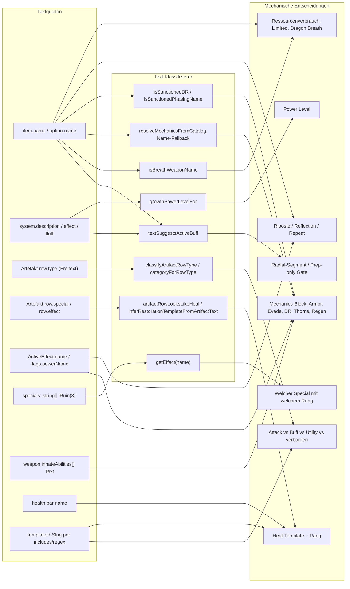
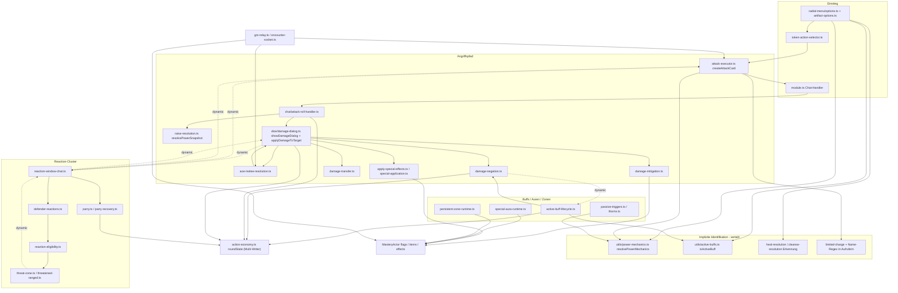
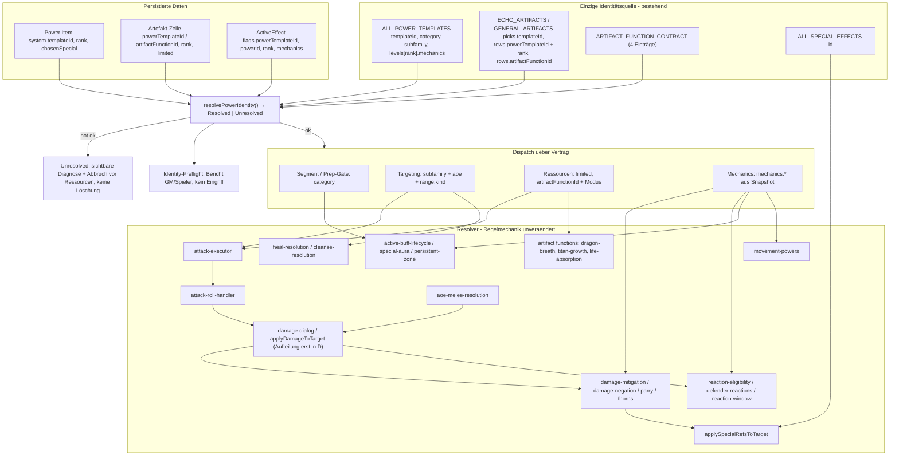
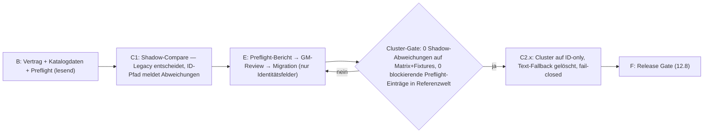

# Combat Resolver — Audit & Plan: ID-basierte Power-Resolution

| | |
|---|---|
| Stand | 2026-11-04 — **Revision 2 (Final Review)** |
| Code-Stand | `main`, Arbeitskopie auf Basis von `85b98314` (release 0.9.823) mit lokalen, nicht committeten Änderungen (Batch 9 Artefakte) |
| Art | Read-only Audit + Refactoring-Plan. **Keine Code-, Daten-, Pack- oder Regeländerungen.** |
| Autoritative Regeln | `docs/Rules/Canonical/Players_Handbook.md`, `Actives.md`, `Active_Buffs.md` — dieser Plan ändert keine Regel. Konflikte zwischen Regelwerk und Code werden gemeldet (10.4), nicht aufgelöst. |
| Genehmigt | Zielarchitektur: bestehender Power Catalog als alleinige Identitätsquelle + zentraler `resolvePowerIdentity()`. |
| Revision 2 | §1 Empfehlung/Reihenfolge; §7 Vertrag bereinigt (Overlay-Modell für Artefakt-Funktionen, keine Entweder-oder-Regel); §9 Preflight + Fail-closed ohne Löschung/Beendigung; §10 Migration über stabile Schlüssel + Herkunftsdaten, vollständige R-05-Prüfung (10.4); §11 Tests erweitert; §12 endgültige Batch-Reihenfolge mit Abnahmekriterien; §12.8 Release Gate; §13/§14 aktualisiert. §2–§6 und §15 unverändert. |
| Revision 2.1 (2026-11-04) | Freigabe-Vermerk: Plan genehmigt; Entscheidung 14.1 (Cleanse-Katalog-Alignment) und 14.2 (R-05-Identitätszuordnungen) **freigegeben** (§14). Neu: 10.4 K5 Scarred-Bar-Restoration HP-Widerspruch PH vs. `Actives.md` (nur dokumentiert, Runtime unverändert); 10.4 K2 um die weiteren Cleanse-Tabellen ergänzt (nicht freigegeben); §12.0 Vorbatch B0 (Cleanse-Alignment) mit Zielwerten; Batch B Umsetzungsliste konkretisiert. Noch keine Code-, Daten- oder Pack-Änderung durchgeführt. |
| Methode | Vollständiger `rg`-Scan über `src/**` (ohne `*.test.ts`) nach `includes/startsWith/endsWith/match/test/indexOf/toLowerCase` auf `name/label/description/effect/special/type/title/fluff`, Regex-Literalen gegen Display-Strings, Lookups nach Anzeigename; manuelle Verifikation aller P0-Stellen; Import-Graph-Analyse `src/combat`, `src/dice`, `src/chat`; Datenmodell (`template.json`, `src/types/item.d.ts`, Templates, Packs); Revision 2 zusätzlich: Regelstellen PH/Actives.md zu R-05, Katalog-Tabellen `actives.ts`/`r05-pools.ts`, Authored-Pick-Builder, Pack-Zeilenschlüssel-Eindeutigkeit. |

---

## 0. Inhalt

1. Executive Summary
2. Klassifizierung und Begriffe
3. Heute vorhandene technische Identitäten und Kategorien
4. Vollständiges Inventar der Text-Matching-Risiken (P0 / P1 / P2 / OK)
5. Textbasierte Identifikationspfade (Diagramm)
6. Ist-Architektur der Combat-Resolver (Diagramm, Abhängigkeiten, Zyklen, State, Duplikate)
7. Bereinigter technischer Identitätsvertrag
8. Zielarchitektur (Diagramm, Resolver-Entscheidungen)
9. Fail-closed: Preflight-Validierung, Fehleranzeige, keine Löschung
10. Legacy-Migration und Cutover-Strategie (inkl. R-05-Prüfung)
11. Regressionsstrategie und konkrete Testfälle
12. Endgültige Batch-Reihenfolge mit Abnahmekriterien und Release Gate
13. Antworten A–E
14. Offene Entscheidungen
15. Anhang: Suchmuster, Nachbar-Domänen, kosmetische Treffer

---

## 1. Executive Summary

**Befund.** Das System besitzt bereits eine stabile technische Power-Identität: den kebab-case `templateId` aus `src/utils/powers/templates/*.ts` (`PowerTemplate.templateId`, Katalogkategorie `PowerTemplate.category`, `subfamily`, strukturierter `mechanics`-Block pro Rang). Neu erzeugte Power-Items (`power-item-builder.ts`), Character-Import (`templateId` Pflicht), Artefakt-Picks (`progressionPickSpecs.templateId`), kompilierte Artefakt-Zeilen (`levelProgression[].powerTemplateId`), Stone Powers (`stonePowerId` + Alias-Tabelle), Manöver (`CombatManeuver.id`), Specials (`SpecialEffect.id`) und Status-Effekte (`id`) sind ID-basiert.

**Problem.** Die Resolver nutzen diese IDs nur als **ersten Treffer in einer Kaskade**. Fast überall folgt ein Text-Fallback (`name`, `description`, Artefakt-Spalte `type`/`special`/`effect`, Effekt-Name, Health-Bar-Name, Waffen-`innateAbilities`-Text), der bei fehlender oder unerwarteter ID **still** greift und eine Mechanik, eine Kategorie, einen Ressourcenverbrauch oder sogar ein Power Level bestimmt. Der bekannte `stance`-in-`instance`-Fehler wurde nur lokal per Wortgrenze (`/\bstance\b/`) entschärft (`radial-menu/options.ts:594`); dieselbe Fehlerklasse existiert an weiteren Stellen (z. B. `entry.name.includes(chosen.id)` bei Special Increase, `name.includes('weapon damage')` bei Riposte, `/\bheal\b/` auf Artefakt-Fließtext, deutsche Regex `schadensreduktion` als DR-Berechtigung).

**Zahlen.** 45 P0-Cluster (Text entscheidet direkt eine Combat-Mechanik), 52 P1-Cluster (Text entscheidet Kategorie/Routing indirekt oder über ID-Slug-Regex), 9 P2, ~40 rein kosmetische Treffer. Vollständige Tabellen in Abschnitt 4.

**Datenlage.** Im Compendium `src/packs/echo-artifacts` (243 Artefakt-Items, 606 Progressionszeilen) tragen 316 Zeilen eine `powerTemplateId`; **alle** Zeilen vom Typ Active Buff / Reaction / Movement / Melee / Ranged / AoE / Limited sind bereits ID-gebunden. Ohne ID sind nur 290 Zeilen der Typen `Stone Power Support` (181), `Artifact Function` (31), `Stone Pool` (23), `Active, Support` (19), `Passive` (18), `Transformation` (10), `Stone Refresh` (8). Davon sind genau **13 benannte, aktivierbare Funktionen** (Artifact Awakening, Burden Lifted I–II, Hearth Circle I–II, Remembered Hands I–II, Life Absorption I–III, Titan Growth I–III) heute ausschließlich über Text identifizierbar. Stone-Funktionen sind strukturiert (`stoneFunction.kind`, `stonePowerId`). Revision 2: Die Quelldefinition `echo-artifacts.ts:1672–1730` trägt für Hearth Circle I–II und Remembered Hands I–II bereits `powerTemplateId`; der Authored-Pick-Builder (`echo-artifacts.ts:2197–2209`) verwirft das Feld beim Kompilieren, deshalb fehlt es im Pack. Der Zeilenschlüssel `(echoArtifactKey, level)` ist über alle 243 Pack-Items eindeutig (0 Duplikate).

**Empfehlung.** Keine neue Registry. Der vorhandene Template-Katalog (`ALL_POWER_TEMPLATES`, `power-catalog.ts`) wird alleinige Identitätsquelle. Ergänzt wird ein kleines Feld `artifactFunctionId` für vier maßgeschneiderte Artefakt-Funktionen (Dragon Breath, Titan Growth, Life Absorption, Artifact Awakening) als **Overlay**, das neben einer `powerTemplateId` stehen darf (Dragon Breath = Katalogmechanik `active-melee-weapon-aoe` + Artefakt-Overlay Ressource/Modi). Ein einziger kleiner Resolver `resolvePowerIdentity()` liefert `Resolved | Unresolved`; alle Routing-Entscheidungen lesen nur noch `category`, `subfamily`, `templateId`, `rank`, `mechanics`, `artifactFunctionId`. Unresolved bricht vor jedem Ressourcenverbrauch sicher ab, mit sichtbarer Diagnose für GM und Spieler, ohne Raten, ohne Löschung oder Beendigung bestehender Items/Effekte. Legacy-Daten werden über **stabile technische Schlüssel** (`echoArtifactKey`+`level`, `flags.powerId`, exakte `templateName`-Herkunft, `specialKeyFromLabel`→`getEffectById`) in einer GM-ausgelösten Migration mit Vorab-Bericht zugeordnet; `rowName` ist nie dauerhafter Schlüssel.

**Reihenfolge (endgültig).** A Audit (dieses Dokument) → B Identitätsvertrag + Katalogdaten + Preflight (read-only) → C1 Shadow-Compare (Legacy entscheidet weiterhin, ID-Pfad läuft parallel und meldet Abweichungen; keine neue Textlogik) → E Preflight-Bericht + Migration über stabile Schlüssel → C2 Cutover pro Cluster (Text-Fallbacks gelöscht, fail-closed; erst nach bestandenem Cluster-Gate) → F Release Gate (keine mechanische Texterkennung, keine ungeprüften Legacy-Daten). D (Architektur-Refactoring: `damage-dialog`-Aufteilung, Reaction-Zyklen, zentrale State-Schreibzugriffe) ist **ausdrücklich getrennt** und folgt nach F als eigenes Vorhaben. Kein Zwischenstand mit wirksamen Text-Fallbacks wird als „ID-basierte Architektur abgeschlossen“ veröffentlicht.

---

## 2. Klassifizierung und Begriffe

| Stufe | Definition | Beispiel |
|---|---|---|
| **P0** | Text (Name, Beschreibung, Label, Zeilentyp-String, Effekt-Name, Bar-Name) entscheidet **direkt** eine Combat-Mechanik: welcher Resolver, welche Power, welcher Mechanics-Block, welches Power Level, welche Ressource, welcher Special. | `/moonlight\s*judgment/i.test(optionName)` → Limited-Charge wird verbraucht |
| **P1** | Text entscheidet **indirekt** eine mechanische Kategorie oder eine Routing-Vorstufe; oder ein **ID-Slug** wird per Substring/Regex interpretiert (technische ID, aber implizite Taxonomie); oder Text wird als Serialisierungsformat einer Mechanik geparst (`"Ruin(3)"`). | `tid.includes('evade')`, `parseAoEShape("Radius 3m")`, `tags.includes('stance')` mit UI-editierbarem Tag |
| **P2** | Text für nichtkritische Datenzuordnung (Picker-Ausblendung, Analyse-Tools, Skripte). | `entry.templateId.includes('dispel')` zum Ausblenden |
| **OK** | Rein kosmetisch: Anzeige, Suche, Chat-Formatierung, Logging. | `formatRadialPowerDisplayName` |

Begriffe:

- **templateId** — kebab-case Katalog-ID (`ab-armor`, `active-ranged-single-target-damage-transfer`, `passive-parry`, `reaction-riposte`, `movement-teleport`). Stabil über Rebuilds, Seeds, Imports. Nicht zu verwechseln mit Foundry `_id`/`uuid`.
- **category** — `PowerCategory = 'active' | 'activeBuff' | 'reaction' | 'passive' | 'movement'` (Katalog). Parallel existiert das Legacy-Feld `powerType = 'active' | 'buff' | 'utility' | 'passive' | 'reaction' | 'movement'` (Item).
- **mechanics** — strukturierter Block (`PowerMechanics`, `src/types/item.d.ts:248–635`), z. B. `armor`, `thornsDice`, `splitAttack`, `specialOnly`, `persistentZone`, `limited` (Item), `healing`, `damageNegation`, `parryRecoveryPerRound`, `repeatable`, `movementMode`, `phasing`, `damageReductionPct`, `autofire`, `growthForm`, `activeSpecialAura`.
- **Artefakt-Zeile** — `ArtifactLevelProgressionRow` (`item.d.ts:1023–1048`): `level, name, type (Freitext), range, aoe, duration, effect, special, powerTemplateId?, chosenSpecialKey?, isSpell?, limited?, embeddedPowerId?`.

---

## 3. Heute vorhandene technische Identitäten und Kategorien

### 3.1 Identitätsquellen (bestehend, wiederverwendbar)

| Domäne | Stabile ID | Kategorie-/Typ-Metadaten | Definiert in | Status |
|---|---|---|---|---|
| Power-Templates (SoT) | `templateId` | `category`, `subfamily`, `tags`, `specialSlot`, `levels[rank].mechanics`, `mechanics` | `src/utils/powers/templates/_shared.ts:29–37`, `index.ts:46–56` (`getTemplate`) | vollständig |
| Katalog-Einträge | `templateId` (+ `chosenSpecial.key`) | `category`, `subfamily`, `tier`, `specialKeys`, `effectTypes` | `src/utils/power-catalog.ts` (`findCatalogEntry`, `filterCatalog`) | vollständig; `findCatalogEntryByName` ist Namenslookup (nur Sheet-UI) |
| Power-Item auf Actor | `system.templateId` | `system.category`, `system.subfamily`, `system.chosenSpecial`, `system.rank`, `system.limited`, `system.isSpell`; Legacy: `powerType`, `tags`, `level`, `effect`, `specials: string[]` | `template.json:394–435`, `src/types/item.d.ts:765–828`; geschrieben von `power-item-builder.ts:141–184` | vollständig für katalog-erzeugte Items; leer (`""`) für manuell angelegte Items |
| Active-Buff-Effekt | `flags['mastery-system'].powerTemplateId` (+ `powerId`, `mechanics`-Snapshot) | `activeBuff`, `isUtility`, `artifactActiveBuff`, `growthForm` | `utils/active-buffs.ts`, `utils/artifact-active-buffs.ts:341–370` | vorhanden; Resolver lesen zusätzlich `effect.name` |
| Artefakt-Katalog | `key` (`echoArtifactKey`), Picks: `progressionPickSpecs[].templateId`/`special` | Pick-`kind`, `delivery`, Zeilen-`type` (Freitext) | `src/utils/echo-artifacts.ts`, `echo-artifacts-unbound.ts`, `general-artifacts.ts` | IDs für Katalog-Picks; **authored**-Zeilen teilweise mit `powerTemplateId` in der Quelle, aber ohne im Pack (Builder verwirft, 1.0) |
| Kompilierte Artefakt-Zeile | `levelProgression[].powerTemplateId`, `chosenSpecialKey`, `limited`, `isSpell` | `type` (Freitext, aus Template-Row-Type) | `src/artifacts/progression-compiler.ts:330–350` | 316/606 Zeilen im Pack |
| Artefakt-Item / Pack | `_id` deterministisch aus `nodeId`; `flags.mastery-system.{nodeId, echoArtifactKey, seedVersion, isRoot}` | `artifactKind`, `baseProfile`, `binding` | `scripts/build-echo-artifact-pack.mjs:92`, `seed-artifact-library.ts:98–102` | vollständig |
| Stone-Funktionen | `stoneFunction.kind`, `stonePowerId` (+ `STONE_POWER_ID_ALIASES`) | — | `utils/artifact-stone-functions.ts:53–164`, `stones/stone-powers.ts:112–115` | vollständig, **Referenzmuster** für Alias-Tabellen |
| Specials | `SpecialEffect.id` (`getEffectById`) | `category` (`instant`…), `polarity`, `hasValue` | `src/utils/special-effects.ts` | ID vorhanden; Pipeline transportiert aber Display-Strings `"Ruin(3)"` |
| Status-Effekte | `id`, `flags.core.statusId`, `effect.statuses` | — | `src/system/status-effects.ts`, `assign-status.ts` | ID vorhanden; mehrere Name-Fallbacks |
| Manöver | `CombatManeuver.id` | `slot`, `tags` | `src/system/combat-maneuvers.ts:59–65` | vollständig |
| NPC-Angriffe | Index-/Phasen-Key, `npcRangeKind`, strukturierte Felder | — | `src/utils/npc-attack-model.ts` | vollständig ID/struktur-basiert |
| Character-Import | `templateId` Pflicht; Artefakte `spec.key` | — | `src/import/character-import-validation.ts:57–65` | vollständig |
| Movement Powers | `templateId` (`MOVEMENT_TEMPLATES`), `mechanics.movementMode` | — | `src/combat/movement-powers.ts` | vollständig im Resolver; Traversal-Kind im Selector per Name (P0-04) |

### 3.2 Zwei parallele Kategorie-Taxonomien

| Feld | Werte | Gelesen von | Problem |
|---|---|---|---|
| `system.category` (Katalog) | `active, activeBuff, reaction, passive, movement` | Sheet, Katalog, `documents/item.ts:47–58` (Sync) | kanonisch, aber Resolver lesen es kaum |
| `system.powerType` (Legacy) | `active, buff, utility, passive, reaction, movement` | `radial-menu/options.ts:782–790`, `active-buffs.ts:82–92`, `token-action-selector.ts`, `parry.ts:68`, `reaction-followups.ts:62`, u. v. m. | Routing hängt an Legacy-Taxonomie; `utility` hat keine Katalog-Entsprechung (bereits als „retired“ markiert in `power-migration.ts:43`, `power-definition-migration.ts:274`, `power-catalog.ts:232`); `buff`/`activeBuff`/`active-buff` werden an >10 Stellen einzeln normalisiert |
| `system.tags` | frei; UI-Preset enthält `'stance'`, `'buff'` (`utils/embedded-power-ui-constants.ts:44–52`) | Segment-Routing (`options.ts:655,676,869`), `active-buffs.ts:101,137,158` | ein vom GM gesetzter Tag `stance` macht aus einer Active eine Active-Buff-Mechanik |
| Artefakt-`row.type` | Freitext (`"Melee, Limited"`, `"Artifact Active"`, `"Active, Support"`, `"Stone Power Support"`) | `classifyArtifactRowType`, `categoryForRowType`, `isActiveProgressionRowType` | drei parallele Freitext-Klassifizierer |

### 3.3 Resolver-Gruppen, die bereits vollständig ID-/struktur-basiert arbeiten

Keine textbasierten Mechanik-Entscheidungen gefunden in:

- `combat/movement-powers.ts` (Budget/Spend via `templateId`), `combat/autofire.ts` (`active-ranged-weapon-autofire` / `mechanics.autofire`), `combat/damage-transfer.ts` (exakte IDs + `mechanics.damageTransfer`; nur `isSpecialOnlyTemplateId` ist verankerte Slug-Regex, P1-20), `combat/special-aura-runtime.ts` (`SPECIAL_AURA_TEMPLATE_IDS`, `flags.powerTemplateId`), `combat/spell-zones.ts`, `combat/spell-roll-handler.ts` (ID-Set für Mental-Surcharge), `combat/limited-charge.ts` (Kern; Text nur bei Aufrufern), `combat/passive-combat-charges.ts`, `combat/absorption.ts` (`passive-absorption`), `combat/damage-mitigation.ts` (reine Arithmetik), `combat/critical-resolution.ts`, `combat/vulnerability-riders.ts`, `combat/fear.ts`, `combat/phasing.ts` (Laufzeit; Berechtigung siehe P0-08), `combat/grapple-*.ts`, `combat/status-tick.ts` (`getEffectById`), `combat/gm-effect-service.ts` (`specialId`), `combat/stone-powers-flow.ts`, `stones/stone-powers.ts` (IDs + Alias-Tabelle), `system/combat-maneuvers.ts`, `utils/npc-attack-model.ts`, `import/character-import-*.ts`, `utils/power-item-builder.ts` (schreibt IDs; nur `/limited/`-Slug P1-22).

---

## 4. Vollständiges Inventar der Text-Matching-Risiken

Spalten: **Ausdruck** (wörtlich), **Mechanik** (was entschieden wird), **Strukturierte Alternative** (bereits vorhanden), **Fehlzuordnung** (plausible falsche Treffer). „Warum vorhanden“ und abhängige Resolver stehen je Cluster darunter.

### 4.1 P0 — Text entscheidet direkt eine Combat-Mechanik (45)

#### A. Power-Routing und Aktivierung

| ID | Datei:Zeile | Funktion | Ausdruck | Mechanik | Strukturierte Alternative | Fehlzuordnung |
|---|---|---|---|---|---|---|
| P0-01 | `src/radial-menu/options.ts:594–596`, Aufrufer `:663`, `:679`, Filter `:1327–1346` | `textSuggestsActiveBuff`, `getSegmentIdForOption` | `/\bbuff\b/i.test(blob) \|\| /\bstance\b/i.test(blob)` auf `name + description` | Segment `active-buff` → Power wird aus dem Combat-Radial entfernt, nur in Preparation aktivierbar, Range 0 | `system.category === 'activeBuff'`, `templateId`, `mech.applyWhen === 'activeBuff-active'` | „enter a stance“ in Beschreibung einer Active; Übersetzung „Haltung“ dreht Verhalten um |
| P0-02 | `src/utils/active-buffs.ts:101–111, 137–147, 158–163` | `isTrueActiveBuff`, `isActiveBuff` | `tags.includes('stance')`, `textSuggestsActiveBuff(...)` | Aktivierbarkeit als Active Buff, Ein-Buff-Ersetzung (Z01), Prep-Fenster | `category`, `templateId`, `mechanics.applyWhen` | UI-Tag `stance` (Preset) auf beliebiger Power |
| P0-03 | `src/radial-menu/options.ts:939–988` | `getAllCombatOptionsForActor` | `/ranged/i.test(typeStr)`, `/zone/i.test(typeStr)`, `/melee/i.test(typeStr)` auf `levelData.type` | Hostile-Zone-Platzierung vs. Melee-Burst-AoE vs. Einzelziel → anderer Targeting-/Damage-Pfad | `levelRow.aoe.shape/center`, `subfamily === 'persistent-zone'`, `mechanics.persistentZone`, `range.kind` | Row-Type „Melee Zone“, „Ranged, Melee“; Template-Row-Type-Text umbenannt |
| P0-04 | `src/token-action-selector.ts:759–765` | `movementTraversalKind` | `name.includes('teleport')`, `name.includes('disengage')`, `name.includes('safe movement')` | Teleport ignoriert Pfad/Gelände/OA; Safe Movement; Disengage-Regeln | `mechanics.movementMode`, `movementTemplateId`, Manöver-`id` | Power „Teleport Strike“ (Active) als Teleport-Bewegung |
| P0-05 | `src/token-action-selector.ts:1698–1701` | Utility-Zweig | `/titan\s*growth/i.test(name)`, `/transformation/i.test(artifactRowSpecial)` | Transformation-Flow (`activateArtifactActiveBuff`) statt Utility-Targeting | `artifactFunctionId` (neu), `row.powerTemplateId` | Umbenennung der Zeile; „Transformation“ in Special-Spalte eines anderen Effekts |
| P0-06 | `src/utils/power-mechanics.ts:218–260` | `resolveMechanicsFromCatalog` (Fallback) | `canonicalPowerLookupName(name) === canonicalPowerLookupName(t.name)`; dann `templateName` + `category/powerType` | **Welcher Mechanics-Block** (Armor, Evade, Thorns, DR, Regen, Riders…) für Items ohne `templateId` | `templateId` (vorhanden für alle Katalog-Items) | `templateName` „Armor“ existiert als Passive/Reaction/Buff; umbenanntes Item greift anderes Template |
| P0-07 | `src/utils/power-mechanics.ts:334–371` | `isSanctionedDR` | `/\bdamage\s+reduction\b/i`, `/\b(schadens\s*reduktion\|schadensreduktion)\b/i`, `stripped.endsWith('damage reduction')` | Prozentuale Damage Reduction wird akzeptiert oder verworfen | `templateId ∈ {passive-damage-reduction, ab-damage-reduction, reaction-damage-reduction}` (steht bereits daneben) | Beliebige Power namens „… Damage Reduction“ erhält DR; Übersetzung entscheidet |
| P0-08 | `src/utils/power-mechanics.ts:374–385` | `isSanctionedPhasingName` | Normalisierter Power-**Name** vs. `PHASING_SANCTIONED_POWER_NAMES`/Aliase | Phasing-Berechtigung (Ladungen) | `templateId` (`passive-ghostform`, `ab-phasing`, `reaction-ghost-slip`), `mechanics.phasing` | Umbenennung/Übersetzung entzieht Phasing |
| P0-09 | `src/utils/artifact-active-buffs.ts:186–188, 263, 267` | `activateArtifactActiveBuff` | `/titan\s*growth/i.test(optionName)`, `artifactRowSpecial.includes('transformation (growth')`, `/moonlight\s*shadow/i.test(optionName)`, `artifactRowSpecial.includes('growth')` | Template-Auswahl: `ab-growth-form` / `ab-sundered-aura` / Growth-Form-Pfad | `option.artifactPowerTemplateId`, `artifactFunctionId` (neu) | Zeile „Moonlight Shadow Step“ → Sundered Aura; „growth“ in beliebiger Special-Spalte |
| P0-10 | `src/utils/artifact-active-buffs.ts:63–72, 298–303` | `growthPowerLevelFor` | `description.match(/power level\s*(\d+)/i)` | **Power Level** aller katalogbasierten Artefakt-Active-Buffs (bestimmt `mechanics`-Zeile) | Pick-/Zeilen-PL als Zahl (`artifactLevelToTemplateRank`, Katalog-PL 4/10/16) | Fließtext „at Power Level 16 the aura…“ setzt PL 16 |

Warum vorhanden: Übergang Trees → Templates (v0.5), Artefakt-Zeilen als Spieler-Handbuch-Transkript; Fallbacks sollten alte Actors ohne IDs weiterbedienen. Abhängige Resolver: komplette Aktivierung (`activateActiveBuff`, Prep-Fenster), `getSegmentIdForOption` → `handleChosenCombatOption` → Attack/Utility/Movement-Pfade, Aggregator (`buildActorMechanicsBreakdown` → Armor/Evade/DR/Thorns für jeden Treffer).

#### B. Artefakt-Funktionen

| ID | Datei:Zeile | Funktion | Ausdruck | Mechanik | Strukturierte Alternative | Fehlzuordnung |
|---|---|---|---|---|---|---|
| P0-11 | `src/radial-menu/artifact-options.ts:59–94` | `classifyArtifactRowType` | `t.includes('reaction'\|'movement'\|'active buff'\|'buff'\|'transformation'\|'stone'\|'support'\|'aoe'\|'attack'\|'limited'\|'zone'\|'barrier'\|'damage'\|'artifact active')`, `t.startsWith('melee'\|'ranged')` auf `row.type` | Attack / Active Buff / Movement / Utility / **verborgen (passive)** | `row.powerTemplateId` → `template.category`; `artifactFunctionId` | „Artifact Active“ (Dragon Head, dokumentierter Bug) → passive; „Support“ in „Active, Support“ → support |
| P0-12 | `artifact-options.ts:276–278, 449–470`; `src/utils/breath-weapon.ts:19–26` | `isBreathWeaponName`, `isDragonBreathDamageMode` | `/breath\s*weapon\|damage\s*breath\|ruin\s*breath/i.test(name)` | Reklassifizierung zu Attack, Cone-Geometrie, shared Pool, Damage-/Ruin-Modus | `artifactFunctionId: 'dragon-breath'`, `option.dragonHeadBreathMode` | Jede Zeile mit „Breath“ im Namen |
| P0-13 | `artifact-options.ts:396–407` | `buildArtifactRadialOptions` | `/\blimited\b/i.test(row.special)`, `/moonlight\s*judgment/i.test(name)`, `/undead\s*tracer/i.test(name)` | Limited-Charge-Gate, `ignoreWeaponDamage`, Disable-State | `row.limited === true` (10/10 Pack-Zeilen gesetzt), `template.limited` | Special-Spalte „not Limited“; Name enthält Alias |
| P0-14 | `artifact-options.ts:180–198` | `artifactRowSupportProfile` | Regex auf `powerTemplateId`-Slug, dann `blob = name+effect+special`: `/\bheal\b/`, `/\bcleanse\b/`, `/(single target\|aoe)\s+restoration/` | Heal- vs. Cleanse- vs. Attack-Targeting | `template.subfamily` (`support-heal`, `support-cleanse`), `mechanics.healing`, `powerTemplateId` auf R-05-Zeilen | Offensive Zeile mit „heal“ im Effekttext |
| P0-15 | `artifact-options.ts:327` | dito | `/transformation/i.test(rowType)` | Utility-Transformation-Zweig | `artifactFunctionId: 'titan-growth'` | Typ-Label |
| P0-16 | `artifact-options.ts:430–431` | dito | `/melee/i.test(rowType) \|\| range === 0 \|\| row.range === 'self'` | Self-zentrierter Burst vs. platzierte Hostile Zone | `template.levels[r].aoe.center`, `range.kind` | Typ „Melee AoE“ vs. „Ranged, Melee“ |
| P0-17 | `src/artifacts/echo-artifact-tree-builder.ts:531–550` | `categoryForRowType` | identisches Muster wie P0-11 | `PowerCategory` der Legacy-`system.powers[]`, `actionCostForCategory` | `powerTemplateId` → `template.category` | dito |
| P0-18 | `src/combat/attack-executor.ts:961–965` | `createAttackCard` | `option.artifactRowSpecial.split(',')` als Specials-Fallback | On-Hit-Specials, wenn Template-Snapshot nicht lädt | `template.levels[r].specials[]`, `chosenSpecialKey` | `"Limited, Spell, Push(2)"` → `Limited`/`Spell` als Special-Namen |

Warum vorhanden: Artefakt-Zeilen wurden aus dem Handbuch als Text übernommen; `powerTemplateId` kam später (Progression Compiler). Abhängige Resolver: Radial → `createAttackCard` → `raise-resolution.loadPowerSnapshotForArtifactOption` → Damage/Specials; Heal/Cleanse-Resolver; `transformation-growth.ts`; `artifact-rest-uses.ts` (Verbrauch).

#### C. Attack / Damage / Specials

| ID | Datei:Zeile | Funktion | Ausdruck | Mechanik | Strukturierte Alternative | Fehlzuordnung |
|---|---|---|---|---|---|---|
| P0-19 | `src/combat/attack-executor.ts:291–304` | `detectSplitAttack` | `/\b(?:melee\|ranged)\s+split attack\b/i.test(option.name + item.name)` | Split-Attack-Fluss (Pool-Teilung, zweiter Strike) | `mechanics.splitAttack` (bereits primär) | Umbenennung; NPC-Label |
| P0-20 | `attack-executor.ts:401–417` | `weaponHasFinesse` | `String(a).toLowerCase().includes('finesse')` auf `innateAbilities[]`, `specialId.includes('finesse')` | Angriffsattribut Agility statt Might | Strukturierte Waffen-Traits (fehlen; Domäne Waffen) | „No finesse required“ als Innate-Text |
| P0-21 | `attack-executor.ts:606–657` | `createAttackCard` | `/moonlight\s*judgment/i.test(optionName)`, `/undead\s*tracer/i.test(optionName)` | **Verbraucht globale Limited-Charge**, `ignoreWeaponDamage` | `isLimitedAttackDeclaration({ limited, artifactLimited, templateId })` (steht daneben) | Name-Alias; Spieler-Umbenennung |
| P0-22 | `attack-executor.ts:659–717` | `createAttackCard` | `/breath\s*weapon\|damage\s*breath\|ruin\s*breath/i.test(optionName)`, Modus `/ruin\s*breath/` | **Verbraucht Dragon-Breath-Nutzung** (Combat + Safe Haven), Ruin vs. Damage, Attribut-Dialog | `option.dragonHeadBreathMode`, `artifactFunctionId` | Beliebige Power namens „Breath …“ verbraucht Ressource |
| P0-23 | `src/combat/threatened-ranged.ts:136–149, 248–249` | `getReachBonusMeters`, `usesThreatenedRangedWeaponRules` | `/reach/i.test(a)`, `/thrown/i.test(a)` auf Innate-Text | Melee-Reach → Threatened-Ranged-Eignung / OA-Fenster | Strukturierte Waffen-Traits (fehlen) | „Reaches 2 targets“ |
| P0-24 | `src/dice/damage-dialog.ts:1754–1762` | Raise-Allokations-Sync | `base === name.toLowerCase() \|\| raw.toLowerCase().startsWith(name.toLowerCase())` auf Raise-Labels | Welcher Special aus Raise angewendet wird | `SpecialOption.id`, Snapshot `specials[].key` | Präfix-Kollision (`Mark` / `Marked`, `Root` / `Rooted`) |
| P0-25 | `damage-dialog.ts:546–547, 1804–1805`; `src/combat/apply-special-effects.ts:108–120` | `applySpecialStringsToTarget` | Specials als Strings `"Ruin(3) [Passive: …]"` → `match(/^([^(]+)(?:\((\d+)\))?$/)` → `getEffect(name)` (Name-Fallback `special-effects.ts:683–692`) | **Welcher Special** mit welchem Rang gesetzt wird; Instant-Skip; Challenge-Merge | `PowerSnapshot.specials: {key, rank}` (existiert ab `raise-resolution.ts`), `SpecialEffectReference` | Umbenannter Special (siehe `special-effect-rename-migration.ts`), Lokalisierung, Tippfehler → Special fällt still weg |
| P0-26 | `src/combat/reaction-window-chat.ts:1167–1174` | Special-Increase-Anwendung | `String(entry.name).toLowerCase().includes(chosen.id)` | +MR auf **ersten** passenden Status — ggf. falscher Special | `entry.id === chosen.id` (steht links davon) | `chosen.id = 'mark'` trifft „Marked for Death“; `'root'` trifft „Rooted Stance“ — **exakt die stance/instance-Klasse** |
| P0-27 | `src/combat/cleanse-resolution.ts:134–136` | `getCleanseRankFromPower` | `/Cleanse\s*\((\d+)\)/i.exec(effectText \|\| sys.effect)` | Cleanse(X)-Rang | `levels[r].specials[].{key:'cleanse', rank}`, `mechanics.cleanseMaintenance` | Beschreibung erwähnt anderen Cleanse-Wert |

#### D. Heal / Cleanse

| ID | Datei:Zeile | Funktion | Ausdruck | Mechanik | Strukturierte Alternative | Fehlzuordnung |
|---|---|---|---|---|---|---|
| P0-28 | `src/combat/heal-resolution.ts:165–176, 218` | `artifactRowLooksLikeHeal`, `isHealRadialOption` | `/\bheal\b/i.test(name+description+special)` mit Ausschluss `/requiem\|exorcism\|damage\|…/` | Grünes Ally-Targeting statt Attack-Pipeline | `artifactPowerTemplateId`, `subfamily` | „heals 0 HP“ in offensivem Text; Übersetzung „heilt“ |
| P0-29 | `heal-resolution.ts:264–311` | `healPowerItemFromRadialOption` | `/moonlight\s*mending/`, `/ranged\s+single\s+target\s+heal/`, `/melee\s+single\s+target\s+heal/` auf Blob → **synthetisches Power-Item** mit `templateId` + `rank` | Welche Heal-Template und welcher Rang gewürfelt wird | `row.powerTemplateId` + PL als Zahl | Technical-Reference-Text in Beschreibung einer anderen Zeile |
| P0-30 | `heal-resolution.ts:322–338` | `inferRestorationTemplateFromArtifactText` | `/\(\s*PL\s*(\d{1,2})\s*\)/`, `/\bAoE\s+Restoration\b/`, `/\bHealing\s+Aura\b/`, `/\branged\b/`, `/\bmelee\b/` | `templateId` (4 Kandidaten) **und PL** aus Text | `powerTemplateId` + `rank` auf den 6 authored R-05-Zeilen | „(PL 4)“ an anderer Stelle im Text; „ranged“ im Fluff |
| P0-31 | `src/combat/cleanse-resolution.ts:66–69` | `isCleanseRadialOption` | `/\bcleanse\b/i.test(blob)` | Cleanse-Routing | `subfamily === 'support-cleanse'` | „cannot be cleansed“ |
| P0-32 | `heal-resolution.ts:440–453` | `applyHealHpAcrossOpenBars` | `nameOf(bar).includes('incapacitat'\|'broken')` | Welche Health Bar geheilt wird (Domäne Health Bars) | `health.currentBar`, Bar-Index | Lokalisierte/umbenannte Bar-Namen |

#### E. Defense / Mitigation

| ID | Datei:Zeile | Funktion | Ausdruck | Mechanik | Strukturierte Alternative | Fehlzuordnung |
|---|---|---|---|---|---|---|
| P0-33 | `src/combat/damage-negation.ts:508–513` | DN-Buff-Scan | `name.includes('damage negation pool'\|'reinforced damage negation')` | Active-Buff-DN-Pool (Ledger, Verbrauch) | `flags.powerTemplateId === 'ab-reinforced-damage-negation'`, `flags.mechanics.damageNegationPoolMax` | Umbenannter Buff |
| P0-34 | `src/combat/active-buff-lifecycle.ts:266–271` | `snapshotPrepDamageNegationOnEnd` | identisch | Prep-Snapshot DN | dito | dito |
| P0-35 | `src/combat/parry.ts:56–74` | `findPassiveParryItem` | `name === 'parry'`, `name.endsWith(': parry')`, `name.includes('passive: parry')`, Skip `includes('reinforced')` | Welches Item den passiven Parry-Pool stellt | `templateId === 'passive-parry'` (erster Treffer) | Custom-Passive „Parry“ |
| P0-36 | `parry.ts:409–420` | `isRiposteReaction`, `isReflectionReaction` | `name.includes('riposte'\|'weapon damage'\|'reflection')` | Riposte- vs. Reflection-Routing nach Fully Parried | `templateId ∈ {reaction-riposte, reaction-parry-reflection}` | „weapon damage“ in anderer Reaction |
| P0-37 | `src/combat/parry-recovery.ts:53–59` | `readParryRecoveryCap` | `name.includes('parry recovery'\|'reinforced parry')` | Parry-Recovery-Cap | `templateId ∈ {ab-reinforced-parry, ab-parry-recovery}`, `mechanics.parryRecoveryPerRound` | Umbenennung |
| P0-38 | `src/combat/thorns.ts:33–34, 63–64` | `slottedPassiveThornsDice`, `activeBuffThornsDice` | `item.name.includes('thorns')`, `/\bthorns\b/.test(name)` | Thorns-Würfel aktiv | `templateId ∈ {passive-thornhide, ab-thorns}`, `mechanics.thornsDice` | „Thorns“ in anderem Namen |
| P0-39 | `src/combat/passive-regeneration.ts:77–82` | `isPassiveRestorationIdentity` | `/^passive\b/i.test(name) && /restoration\|regeneration/i.test(name)` | Passive Regeneration pro Tick | `PASSIVE_REGENERATION_TEMPLATE_ID`, `mechanics.regen` | Custom-Name |
| P0-40 | `src/combat/hollow-crown.ts:62–67` | Artefakt-Scan | `/hollow\s*crown/i.test(item.name)` (+ `echoKey`) | Deathless-Body-Stufe | `system.echoKey`/`echoArtifactKey === 'hollowCrown'` | Umbenanntes Artefakt |
| P0-41 | `src/combat/perception-state.ts:216–222` | `lostHealthBarsForInvis` | `name.includes('incapacitat'\|'broken'\|'wound'\|'injur'\|'bruise'\|'healthy')` | Invisibility-Perception-TN (Domäne Health Bars) | Bar-Index | Lokalisierung |
| P0-42 | `src/system/auto-fail.ts:89, 123` | Auto-Fail | `/^disoriented/i`, `/^stunned/i` auf Effekt-Name/Label | Auto-Fail-Rang (Domäne Status) | `effect.id`, `flags.core.statusId` | Umbenannter Status |

#### F. Reactions

| ID | Datei:Zeile | Funktion | Ausdruck | Mechanik | Strukturierte Alternative | Fehlzuordnung |
|---|---|---|---|---|---|---|
| P0-43 | `src/combat/reaction-eligibility.ts:186–187` | `reactionMayRepeatThisRound` | `name.includes('parry + weapon damage'\|'riposte')` | Reaction mehrfach pro Runde nutzbar | `templateId === 'reaction-riposte'`, `mechanics.repeatable` | Name |
| P0-44 | `reaction-eligibility.ts:311–317` | `evaluateReactionEligibility` | `name.includes('weapon damage'\|'riposte'\|'attack reflection'\|'reflection')` | Anzeige/Freigabe der Parry-Follow-ups | `templateId` | dito |
| P0-45 | `src/combat/reaction-window-chat.ts:763–765` | Reaction-Spend | `power.name.includes('parry + weapon damage')` | Überspringt `markPowerUsedThisRound` | `templateId === 'reaction-riposte'` | dito |

Warum vorhanden (C–F): Jede dieser Stellen hat heute bereits den ID-Pfad **davor**; der Text-Zweig ist ein stehen gebliebener Übergangs-Fallback. Abhängige Resolver: Attack-Executor → Roll-Handler → Damage-Dialog → `applyDamageToTarget` → Mitigation/DN/Parry/Thorns/Reactions → Specials → Status-Liste; Ressourcen (`limited-charge.ts`, `artifact-rest-uses.ts`).

### 4.2 P1 — Indirekte Kategorie-/Routing-Entscheidung, Slug-Regex, textuelle Serialisierung (52)

| ID | Datei:Zeile | Ausdruck | Entscheidet | Strukturierte Alternative |
|---|---|---|---|---|
| P1-01 | `src/radial-menu/options.ts:736–748` (`lookupTemplate`) | `t.templateName === powerName \|\| t.name === powerName` | Level-Row (Range/AoE/Zone) bei fehlender `templateId` | `templateId` |
| P1-02 | `src/combat/raise-resolution.ts:757–759` | `t.templateName === powerItem.name \|\| t.name === powerItem.name` | Power-Snapshot (Specials, Dice) ohne `templateId` | `templateId` |
| P1-03 | `src/migrations/power-template-resync-migration.ts:60–79` | `ALL_POWER_TEMPLATES.find(t => t.name === itemName)` | Resync gebackener Levels | `templateId`; sonst explizite Mapping-Tabelle |
| P1-04 | `src/sheets/character-sheet-power-dialog.ts:237, 684, 741`, `character-sheet-power-replace-dialog.ts:229, 357, 470` | `findCatalogEntryByName(selectedName)` | Welche Katalog-Entry bei UI-Auswahl erzeugt wird (`e.name` ist eindeutig, aber Display-String) | `templateId` als `<option value>` |
| P1-05 | `options.ts:510–547` (`parseAoERadius/Shape`) | `includes('radius'\|'burst'\|'aura'\|'zone'\|'cone'\|'line')` auf AoE-String | Platzierungsprofil | `AoeSpec` (Objekt) |
| P1-06 | `options.ts:561–586` (`determineTargetGroup`) | `desc.includes('allies'…)`, `name.includes('bless'\|'beacon'\|'healing'\|'feather fall')` | Default-Zielgruppe Utility | `aoe.targetFilter` |
| P1-07 | `options.ts:315–326` (`calculateRange`) | `innateAbilities.find(a => a.includes('Reach'))` + Regex | Melee-Reichweite | Waffen-Traits |
| P1-08 | `options.ts:1083–1086` | `/zone/i.test(levelData.type)` | Zielgruppe Creature vs. Enemy | `mechanics.persistentZone` |
| P1-09 | `options.ts:1183` | `/^load\b/i.test(innate)` | Reload-Manöver angeboten | Waffen-Trait `load` |
| P1-10 | `options.ts:655–658, 676, 865–870`; `active-buffs.ts:101, 137, 158`; `utils/embedded-power-ui-constants.ts:44–52` | `tags.includes('active-buff'\|'buff'\|'stance')` | Buff-Routing über **UI-editierbaren** Tag | `category` |
| P1-11 | `artifact-options.ts:98–118` (`parseRowRange/Aoe`) | Regex auf `row.range`/`row.aoe` | Reichweite/AoE-Form | Template-`RangeSpec`/`AoeSpec` via `powerTemplateId` |
| P1-12 | `src/artifacts/echo-artifact-tree-builder.ts:577–615` | `includes('touch'\|'melee'\|'cone'…)`, `/(\d+)\s*m/`, `includes('mastery')` | Legacy-`system.powers[]` Range/AoE/Duration | dito |
| P1-13 | `src/artifacts/progression-compiler.ts:318–329` | `isBreathWeaponName(rowName)` → Display-Type/Range | Erzeugt den Text, den P0-11/12 wieder parsen | `artifactFunctionId` |
| P1-14 | `src/utils/echo-artifacts.ts:2242–2256` | `bv.label.toLowerCase().includes('damage'\|'armor'\|'evade'\|'move'\|'cling')` | `baseValues[].type` (weaponDamage/armor/evade/movement) bei Item-Erzeugung | explizites `type` in den Katalog-Tabellen |
| P1-15 | `src/utils/artifact-visible-abilities.ts:39–46` | `/artifact\s*function/i && /awakening/i`, `/^true\b/i.test(name)` | Capstone-Zeile / sichtbare Stufen | `row.level === 10`, `artifactFunctionId` |
| P1-16 | `src/artifacts/node-editor.ts:772–773` | `o.label === storedLabel` | Weapon-Special-Base-Value → Special-ID | `specialId` persistieren |
| P1-17 | `src/combat/heal-resolution.ts:155–162, 183–189` | `/health-level-heal/`, `/aoe-restoration/`, `/\bheal\b/` auf `templateId`-Slug, `/support-heal/` auf `subfamily` | Heal-Erkennung | `subfamily ===`, `mechanics.healing` |
| P1-18 | `src/combat/cleanse-resolution.ts:33–36` | `/\bcleanse\b/` auf Slug | Cleanse-Erkennung | `subfamily === 'support-cleanse'` |
| P1-19 | `src/combat/limited-charge.ts:28–42` | `/heal\|restoration\|zone\|mental\|control…/i.test(templateId)` | Verbotene Limited-Templates | explizites ID-Set / `template.limited` + `subfamily` |
| P1-20 | `src/combat/damage-transfer.ts:84–92` | verankerte Regex `^active-(melee\|ranged)-instant-special-t[3-6]$` … | Special-only | `mechanics.specialOnly` (existiert parallel) |
| P1-21 | `src/combat/r05-restoration.ts:104–111` | Slug-Regex | Scarred-Bar-Restoration | ID-Set |
| P1-22 | `src/utils/power-item-builder.ts:171–174` | `/limited/i.test(templateId)` → `system.limited` | Limited-Flag bei Erzeugung | `template.limited` allein |
| P1-23 | `src/utils/power-catalog.ts:285` | `templateId.includes('active-ranged')` | Spell-Eignung | `spellHints`/Flag |
| P1-24 | `src/combat/active-buff-lifecycle.ts:474–484` | `tid.includes('temp-hp'\|'temphp')` | Prep- vs. Turn-Refresh Temp HP | `mechanics.preparationTempHP` |
| P1-25 | `src/combat/reaction-eligibility.ts:131, 155, 230, 315` | `tid.includes('riposte'\|'reflection'\|'phasing'\|'ghost-slip')`, `subfamily.includes('reposition')` | Reaction-Klassen | exakte IDs / `subfamily ===` |
| P1-26 | `src/combat/defender-reactions.ts:172–208` | `tid.includes('evade'\|'guard'\|'pure-defense')`, `/\bevade\b/`, `/\bguard\b/`, `/\bally\b/` auf Name | Dedupe Basic Reactions, Ally-Reaction | `mechanics.evade/armor`, `subfamily === 'ally'`, `tid.startsWith('reaction-ally-')` |
| P1-27 | `src/combat/reaction-followups.ts:60–63` | `tid.includes('absorption') \|\| name.includes('absorption')` | Reactive-Overload-Voraussetzung | `templateId === 'passive-absorption'` |
| P1-28 | `src/combat/persistent-zone-runtime.ts:61–67` | `tid.includes('zone') && tid.includes('ranged')`, `/persistent\s*zone\|ranged\s*zone/i.test(typeStr)` | Persistent-Zone-Power | `subfamily === 'persistent-zone'`, `mechanics.persistentZone` |
| P1-29 | `src/combat/movement-allowance.ts:60–62`, `token-move-gate.ts:38` | `id.includes('reposition')`, `id.startsWith('movement-')` | Bewegungsart / Gate | `mechanics.movementMode` |
| P1-30 | `src/combat/apply-special-effects.ts:59–60` | `id.includes('regeneration')` | Ward-Bypass | `effect.polarity === 'positive'` (steht darunter) |
| P1-31 | `src/utils/weapon-specials.ts:18–58`, `src/utils/special-effects.ts:683–692, 712–726` | `"Label(N)"` → `specialKeyFromLabel` → `getEffect(name)` (Name-Vergleich als Fallback) | Waffen-/Power-Specials-Identität aus Display-String | `ArtifactWeaponSpecialRef {specialId, value}`, `PowerSpecial {key, rank}` |
| P1-32 | `src/dice/damage-dialog.ts:1969–2004` (`collectAvailableSpecials`) | `startsWith('split attack'\|'autofire')`, `id` aus slugifiziertem Namen | Raise-Picker-Optionen | `specials[].key` |
| P1-33 | `src/system/pool-reduction.ts:80–82, 167–168, 268–274, 352–356` | `name === 'challenge'`, `eff.name.toLowerCase() === name` | Challenge-State, Cleanse-Eignung | `entry.id` |
| P1-34 | `src/combat/special-application.ts:80–82` | `getEffect(name)` | HUD-Special-Klassifikation | `getEffectById` |
| P1-35 | `src/combat/raise-resolution.ts:413, 675` | `getEffectById(key) ?? getEffect(key)` | Raise-Special-Bindung | nur `getEffectById` |
| P1-36 | `src/system/assign-status.ts:163–166`, `src/combat/surprise.ts:36–37`, `invisibility-presentation.ts:123` | Effekt-Name → Status-ID; `name === 'surprise'`; `name === 'invisible'` | Status-Mechanik | `statuses`, `flags.core.statusId` |
| P1-37 | `src/combat/attack-executor.ts:1116–1118` | `/^counterattack\b/i.test(option.name)` | Counterattack-Flag / Await | `option.tags`, `templateId` |
| P1-38 | `attack-executor.ts:1239` | `!/instant/i.test(zoneDurationNote)` | `persistentSpellZone` | `duration.kind` |
| P1-39 | `damage-dialog.ts:818–821` | `powerSystem.effect.match(/(\d+d\d+)/)` | Fallback-Schadenswürfel | `levelRow.effect.dice`, mechanics |
| P1-40 | `defender-reactions.ts:271–274, 302`; `reaction-eligibility.ts:141, 367–368` | Regex auf `system.trigger`, `/d8/` auf Rider, `blob = tid+subfamily+trigger+name` | Reaction-Legalität im Threatened-Fenster | `subfamily`, `mechanics` |
| P1-41 | `src/combat/passive-triggers.ts:289–295` | `it.name === slot.passive.name` | Item für Passive-Rider | `slot.passive.id`/`templateId` |
| P1-42 | `src/combat/transformation-growth.ts:210, 227` | `/^Growth\s+\d+/i.test(bar.name)` | Growth-Bars vs. HP-Bars | `bar.growthBar === true` (existiert) |
| P1-43 | `src/token-action-selector.ts:1434–1436` | `/ranged/i.test(option.name)` | Heal-AoE-Platzierung | `range.kind`, `burstMeleeAoE` |
| P1-44 | `token-action-selector.ts:1804–1836, 1905–1906`; `src/utils/actor-helpers.ts:18–38` | `name.includes('prone')`, `label.includes(cond)` | Prone-Entfernung, Blocking-Conditions | Status-ID |
| P1-45 | `src/documents/item.ts:47–58` | `tid.startsWith('passive-')` → `category` | Kategorie-Sync (ID-Präfix) | Katalog-`category` via `getTemplate` |
| P1-46 | `src/migrations/artifact-alignment-2026-10-25.ts:71–81`, `echo-stone-support-resync.ts:23–25`, `r05-healing-migration.ts:44–45, 125–135`, `special-effect-rename-migration.ts:87–106, 140–148` | Name-Regex / `row.name ===` / Display-Map | Migrations-Routing | explizite Mapping-Tabellen (akzeptabel **nur** in Migrationen) |
| P1-47 | `src/artifacts/artifact-awakening.ts:209, 253, 486`, `src/utils/artifact-actor-tree.ts:94–96` | `name.includes('Level 1-1')` | Root-Node | `flags.isRoot`, `nodeId` |
| P1-48 | `src/stones/ally-stone-target.ts:23`, `src/stones/remove-scar.ts:186` | `name.includes('regeneration')`, `/titan scars/i` | Status-Zeile / Scar-Eignung | `id`, `echoArtifactKey` |
| P1-49 | `src/radial-menu/info-panel.ts:119–122` | `/\branged\b/i.test(name+description)` | Vorschau Waffenprofil | `weaponType` |
| P1-50 | `src/utils/minor-magic-items.ts:413–437` | `isActiveProgressionRowType` Substring-Klassifizierer | Minor-Magic-Actives | `powerTemplateId` |
| P1-51 | `src/combat/group-ambush.ts:55–61` | `/stealth/i.test(spec.name)` | Stealth-Pool | `findSpecializationById` |
| P1-52 | `src/creation/tower-wizard/tower-wizard-passive-categories.ts:190` | `id.includes('stone-stance')` | Passive-Kategorie (Creation) | explizite Liste (existiert `:49`) |

### 4.3 P2 — Nichtkritische Datenzuordnung (9)

| ID | Datei:Zeile | Ausdruck | Zweck |
|---|---|---|---|
| P2-01 | `options.ts:134` | `name.includes('artifact only')` | NPC-Katalog-Buff ausblenden |
| P2-02 | `power-catalog.ts:607–613` | `templateId.includes('dispel')` | Dispel aus Pickern |
| P2-03 | `creation/encounter-forge/party-analyzer.ts:214–217` | `cat.includes('buff')` | Analyse |
| P2-04 | `divine-clash/divine-clash.ts` (8 Treffer) | Stone-Actor-Namen | Zuordnung im Divine Clash |
| P2-05 | `stones/summon-bond-spend.ts:515` | `/summon\s*stone/i` | Token-Label |
| P2-06 | `utils/artifact-base-type-catalog.ts:163` | `slug(w.name) === wSlug` | Paperdoll-Basistyp |
| P2-07 | `combat/aoe-melee-resolution.ts:409–414` | Regex auf Notiz-Strings | Chat-Filter |
| P2-08 | `scripts/_batch9f-merge.mjs:22–71` | Namensnormalisierung | Audit-Skript |
| P2-09 | `token-action-selector.ts:1204–1206` | `description.includes('teleport')` | Zweitpfad von P0-04 (nur Guided-Move-Variante) |

### 4.4 OK — Kosmetisch (Auswahl, ~40)

`radial-menu/power-radial-label.ts`, `utils/power-item-builder.ts:63–90` (`defaultPowerItemDisplayName`), `action-economy.resolveUsedCombatPowerName`, `damage-dialog.formatDamageSpecialsLabel`, Chat-HTML (`powerName`, `actor.name`), `movement-tracker`-Labels, `combat-snapshot`-Namen, `power-catalog.filterCatalog` Freitextsuche (`:699–702`), `character-print.ts`, `module.ts powerTypeDisplay`, `artifact-builder.ts:395` (Suffix), `artifact-evolution-actions.ts:280`.

### 4.5 Zählung

| Stufe | Cluster | davon Power-/Artefakt-Identität | davon Nachbar-Domänen |
|---|---|---|---|
| P0 | **45** | 40 | 5 (Waffen-Innate-Text P0-20/23; Health-Bar-Namen P0-32/41; Status-Name P0-42) |
| P1 | **52** | 45 | 7 (Waffen P1-07/09, Bars P1-42, Status P1-36/44, Skills P1-51) |
| P2 | 9 | — | — |
| OK | ~40 | — | — |

Mehrfach implementierte Erkennungen derselben Power/Mechanik (Hauptursache „mehrere Resolver, weil an verschiedenen Stellen dieselbe Power anhand verschiedener Texte identifiziert wird“):

| Mechanik | Stellen |
|---|---|
| Active Buff ja/nein | P0-01, P0-02 (2 Funktionen), `active-buff-lifecycle.ts:33–35` (Kopie), `party-analyzer`, `tower-wizard-echo-advisor` → 6 Prädikate |
| Limited | P0-13, P0-21 (2×), `limited-charge.ts` (ID) → 4 |
| Breath Weapon | P0-12 (2×), P0-22, P1-13 → 4 |
| Heal/Cleanse | P0-14, P0-28, P0-29, P0-30, P0-31, P1-17, P1-18 → 7 |
| Riposte/Reflection | P0-36, P0-43, P0-44, P0-45, P1-25 → 5 |
| Artefakt-Zeilen-Kategorie | P0-11, P0-17, P1-50 → 3 |
| DN-Pool-Buff | P0-33, P0-34 → 2 |
| Thorns | P0-38 (2×) |
| Titan Growth / Transformation | P0-05, P0-09, P0-15 → 3 |

---

## 5. Textbasierte Identifikationspfade (Diagramm)



Kernaussage: Es gibt heute **keinen** einzelnen Punkt, an dem eine Power identifiziert wird. Jeder Resolver identifiziert erneut, mit eigener Kaskade und eigenem Text-Fallback.

---

## 6. Ist-Architektur der Combat-Resolver

### 6.1 Vorhandenes Diagramm

- Quelle: `.archify/architecture-combat-resolvers-20261103-112719/candidate.json` (JSON-Spezifikation, kein Mermaid), gerendert nach `combat-resolvers.html` mit `.agents/skills/archify/bin/archify.mjs deliver architecture candidate.json combat-resolvers.html --quality showcase`. Die öffentliche URL wird im Repo nicht referenziert (manueller Upload); kein npm-Script, kein Workflow. **Nicht geändert.**
- Knoten: Chat-Karten, Attack Executor, Attack Roll Handler, Raise Resolver, Damage Dialog (Hub), applyDamageToTarget (Hub), Mitigation, Damage Transfer, AoE Resolver, Heal·Cleanse, Move·Pursuit, MasteryActor. Es zeigt den Happy-Path und blendet Reactions, Active Buffs, Auren/Zonen, Snapshot-Loader, Socket/Relay und die Identifikationslogik aus (Karte „Grenze“ sagt das explizit).

### 6.2 Vereinfachtes Ist-Diagramm (inkl. der ausgeblendeten Schichten)



### 6.3 Abhängigkeiten, Zyklen, State, Duplikate

**Zyklen (statisch oder per `await import` verdeckt):**

1. `active-buff-lifecycle.ts:10` → `damage-negation.ts` → `:490 await import('./active-buff-lifecycle.js')` (`preparationTargetRound`). Einziger echter statischer Zyklus; beide schreiben `roundState.activeBuffPrepResourceLedger`.
2. `attack-executor.ts:1601` ⇄ `reaction-window-chat.ts:698` (Counterattack).
3. `defender-reactions.ts:522` ⇄ `reaction-window-chat.ts` (deprecated Wrapper `promptDefenderReactionsBeforeMitigation`).
4. `damage-dialog.ts:2262` ⇄ `reaction-window-chat.ts:906/1071`; `damage-dialog.ts` ⇄ `thorns.ts:113`.
5. `aoe-melee-resolution.ts` → `damage-dialog`/`reaction-window-chat`/`attack-executor` → zurück.
6. `reaction-eligibility.ts` → `threat-zone.ts:290` → `reaction-window-chat.ts` → `reaction-eligibility.ts`; `parry.ts` → `reaction-eligibility.ts` → … → `parry.ts`.
7. `autofire.ts:23` importiert `target-defenses` über das Barrel in `attack-executor.ts:49–53`.

`attack-roll-handler.ts` (Header Z. 4–5) wurde aus `module.ts` ausgelagert, um Zyklen zu vermeiden, und nutzt fast ausschließlich dynamische Imports: 153+ `await import(` in `src/combat`, 40+ in `damage-dialog.ts`.

**Gemeinsame State-Mutationen:**

| Schlüssel | Schreiber |
|---|---|
| `flags.mastery-system.roundState` | `action-economy.ts` (`setRoundState` ~709/737), `active-buff-lifecycle.ts` (~188–377), `damage-negation.ts` (~549), `parry.ts` (~259, 335), `npc-maximization.ts`, `turn-state.ts`, `flee.ts`, `attack-roll-handler.ts` (~683, 796), `damage-dialog.ts` (~3586–3593), `utils/active-buffs.ts`, Stones — **kein Transaktionsrahmen**; `rs` wird mehrfach in-memory mutiert, bevor persistiert wird |
| `roundState.stoneBonuses.tempDamageNegation` | `damage-negation.ts` (~211, 435), `action-economy.resetRoundState` (~2536), `stone-powers.ts` (~685) |
| `roundState.activeBuffPrepResourceLedger` | `active-buff-lifecycle.ts` (~280–376), `damage-negation.ts` (~492–549) |
| Actor-Statusliste (`writeActorStatusList`) | `apply-special-effects`, `special-application`, `status-tick`, `combat-snapshot`, `gm-effect-service`, `damage-dialog` (~2095, 2397), `reaction-window-chat` (~1177) |
| Combat-Flags (`activeBuffPrepClosedRound`, `specialAuraApplied`, `stonePowersState`) | `active-buff-lifecycle`, `special-aura-runtime`, `stone-powers-flow` |
| Modul-globale Maps/Sets | `gm-relay.ts:8` `pending`, `attack-roll-handler.ts:27` Locks, `damage-transfer.ts:15` `processedDamageTransferIds` |

`combat-snapshot.ts:23–50` (`COMBAT_ACTOR_FLAG_KEYS`) dokumentiert die beabsichtigte Ownership, erzwingt sie aber nicht.

**Doppelte Berechnungs-/Erkennungspfade:**

| Cluster | Funktionen |
|---|---|
| Power-Item-Lookup | `power-mechanics.findPowerItemOnActor`, `damage-dialog.resolvePowerItemForDamage:227`, `reaction-window-chat.findPowerForActor:681` |
| Power-Snapshot | `attack-executor` lädt; `damage-dialog` und `aoe-melee-resolution` rufen `resolvePowerSnapshot` erneut |
| Hit-Instanz-Anwendung | `damage-dialog.applyDamageToTarget` vs. Copy-Paste-Sequenz in `aoe-melee-resolution.ts` (Phasing → Dialog → Apply → Reactions) |
| Armor/Evade | `target-defenses.ts` (kanonisch) + Barrel in `attack-executor` + `passiveArmorReductionForLevel` zusätzlich in `damage-dialog` (~4046) neben `applyDefensiveMitigation` |
| Specials anwenden | `apply-special-effects`, `special-application`, `gm-effect-service`, `special-aura-runtime`, `persistent-zone-runtime` |
| Aktiver-Buff-Prädikate | siehe 4.5 |

**Unklare Ownership:** Reaction-Window wird von `attack-roll-handler`, `attack-executor`, `damage-dialog`, `aoe-melee-resolution`, `threat-zone` orchestriert; Damage-Apply doppelt (Single/AoE); `roundState` ohne Owner; Specials auf Treffer zwischen vier Modulen aufgeteilt.

**Unnötige Wrapper:** `turn-state.ts` (komplett deprecated), `applyDamageToTargetFromAoe` (`damage-dialog.ts:2171–2178`), `attack-executor.ts:49–53` Re-Export, `promptDefenderReactionsBeforeMitigation` (`defender-reactions.ts:511–533`).

### 6.4 Notwendige Abhängigkeiten vs. Architekturprobleme

| Notwendig / sinnvoll | Tatsächliches Problem |
|---|---|
| `action-economy` als zentraler Round-State-Store | Multi-Writer ohne Transaktionsgrenze (6.3) |
| `raise-resolution.resolvePowerSnapshot` geteilt von Roll, Dialog, AoE | Snapshot wird mehrfach neu aufgelöst, je mit eigenem Name-Fallback (P1-02) |
| `damage-mitigation` (pur) + `target-defenses` (live) | `damage-dialog.ts` ~4k Zeilen: UI + Pool-Mathe + Apply-Orchestrierung + Specials + Reactions |
| `gm-relay`/`encounter-socket` für Nicht-GM-Schreiber | Reaction-Subgraph mit dynamischen Rückkanten zu Executor/Dialog |
| Dynamische Imports in `attack-roll-handler` (ESM-Ladereihenfolge) | `active-buff-lifecycle` ⇄ `damage-negation` statischer Zyklus; Ledger doppelt geschrieben |
| Diagramm bewusst auf Happy-Path reduziert | Keine automatische Synchronisation Imports → `candidate.json` |

**Direkte Antwort auf die Frage, ob wir mehrere Resolver haben, weil dieselbe Power an verschiedenen Stellen anhand verschiedener Texte identifiziert wird: Ja.** Tabelle 4.5 zeigt neun Mechaniken mit 2–7 parallelen Erkennungen; jede Erkennung zog eine eigene Hilfsfunktion und eine eigene Abhängigkeitskante nach sich (z. B. Radial importiert `heal-resolution`/`cleanse-resolution`/`damage-transfer`/`limited-charge` nur zur Erkennung; `active-buffs.ts` importiert `radial-menu/options.ts` für `textSuggestsActiveBuff`).

---

## 7. Bereinigter technischer Identitätsvertrag

Grundsatz: **Bestehende Felder, bestehender Katalog.** Keine zweite Taxonomie, keine zweite Power-Registry. Neu sind genau: (a) ein einziger Resolver `resolvePowerIdentity()` mit explizitem `Unresolved`-Ergebnis, (b) das Overlay-Feld `artifactFunctionId` plus ein numerisches `rank` auf Artefakt-Zeilen, (c) eine vier Einträge große Verträglichkeitstabelle für Artefakt-Funktionen.

### 7.1 Erlaubte und verbotene Eingaben

| Erlaubt (Identität darf daraus gelesen werden) | Verboten (nie Eingabe einer mechanischen Entscheidung) |
|---|---|
| `item.system.templateId`, `item.system.rank` / `level` (numerisch), `item.system.chosenSpecial.key`, `item.system.limited`, `item.system.isSpell` | `item.name`, `system.description`, `system.fluff`, `system.effect` (Text), `system.specials: string[]`, `system.powerType`, `system.tags` |
| `row.powerTemplateId`, `row.artifactFunctionId`, `row.rank`, `row.limited`, `row.isSpell`, `row.chosenSpecialKey`, `row.level` (Artefakt-Stufe), `flags.mastery-system.echoArtifactKey` | `row.name`, `row.type`, `row.range`, `row.aoe`, `row.duration`, `row.effect`, `row.special` |
| `effect.flags['mastery-system'].powerTemplateId`, `.powerId`, `.rank`, `.mechanics`, `.artifactFunctionId` | `effect.name`, `effect.label`, `flags.powerName` |
| `template.category`, `template.subfamily`, `template.levels[rank].{mechanics, aoe, range, roll, specials[].key}`, `template.roll.kind`, `template.cost.action`, `template.limited` | `template.name`, `template.templateName`, `levels[rank].type` (Row-Type-Text), `levels[rank].effect.text` |
| `option.artifactPowerTemplateId`, `option.artifactFunctionId`, `option.dragonHeadBreathMode` (strukturiertes Modusfeld), `option.limited`, `option.maneuver.id` | `option.name`, `option.description`, `option.artifactRowSpecial`, `option.zoneDurationNote` |
| `SpecialEffect.id`, `{ key, rank }`-Referenzen | `"Ruin(3)"`-Strings außerhalb des Legacy-Adapters (10.2 c) |

Diese Tabelle ist die Grundlage des Guard-Tests (11.1) und der Allowlist kosmetischer Treffer (4.4).

### 7.2 Resolver und Ergebnis

```ts
// Vorschlag, keine Implementierung. Ort: src/utils/power-identity.ts (neu, klein, blattnah).
type PowerIdentitySource =
  | { kind: 'power-item'; item: Item }
  | { kind: 'artifact-row'; artifact: Item; row: ArtifactLevelProgressionRow }
  | { kind: 'active-effect'; effect: ActiveEffect }
  | { kind: 'radial-option'; option: RadialCombatOption };

type ResolvedPowerIdentity = {
  ok: true;
  /** Katalog-Identität. null nur bei Artefakt-Funktionen ohne Katalogbasis (Klasse K2). */
  templateId: string | null;
  template: PowerTemplate | null;
  /** Nur aus template.category. Bei K2 aus ARTIFACT_FUNCTION_CONTRACT[fn].category. */
  category: PowerCategory;
  subfamily: string | null;
  /** 1..16, numerisch. Quelle: item.rank/level, row.rank, pick.stagePowerLevels. */
  rank: number;
  chosenSpecialKey: string | null;
  /** resolvePowerMechanicsById(templateId, rank) — ohne Namensfallback. */
  mechanics: PowerMechanics | null;
  limited: boolean;
  isSpell: boolean;
  /** Overlay (Klasse K2/K3), siehe 7.3. */
  artifactFunctionId: ArtifactFunctionId | null;
  /** Artefakt-Stufe 1..10, nur bei Artefakt-Quellen; treibt Funktions-Tabellen (z. B. Breath-Cone). */
  artifactLevel: number | null;
  source: PowerIdentitySource['kind'];
};

type UnresolvedPowerIdentity = {
  ok: false;
  reason:
    | 'missing-identity'                      // weder templateId noch artifactFunctionId
    | 'unknown-template-id'                   // getTemplate() liefert nichts
    | 'unknown-artifact-function-id'
    | 'artifact-function-contract-violation'  // Overlay passt nicht zur templateId (7.3)
    | 'rank-missing'
    | 'rank-out-of-range'
    | 'category-conflict'                     // item.category gesetzt und ≠ template.category
    | 'special-key-unknown';                  // chosenSpecialKey / specials[].key ohne getEffectById-Treffer
  /** Für Preflight-Bericht und Fehleranzeige (9.2): welcher Eingriff folgt. */
  severity: 'blocks-activation' | 'omits-contribution' | 'informational';
  diagnostic: string;
  ref: { actorId?: string; actorName?: string; itemId?: string; itemName?: string; effectId?: string; echoArtifactKey?: string; rowLevel?: number };
  /** Vorschlag ausschließlich aus stabilen Schlüsseln (10.1); nie aus Text. */
  suggestedIdentity?: { templateId?: string; artifactFunctionId?: ArtifactFunctionId; rank?: number; basis: 'echoArtifactKey+level' | 'flags.powerId' | 'templateName-exact' };
};
```

Invarianten:

- I1 Vergleich von Identitäten ausschließlich `templateId === templateId` bzw. `artifactFunctionId === artifactFunctionId`. Nie `name`.
- I2 `resolvePowerIdentity` entscheidet **keine** Mechanik; es liefert Felder. Resolver behalten ihre Regeln (kein Mega-Resolver).
- I3 Keine Text-Eingabe aus 7.1 (rechte Spalte) wird gelesen; der Guard-Test prüft das Modul selbst mit.
- I4 `Unresolved` enthält niemals eine geratene Identität in `templateId`/`artifactFunctionId`; `suggestedIdentity` wird von keinem Resolver gelesen, nur von Preflight/Migration.
- I5 `PowerGrantSpec` (`power-item-builder.ts:31–38`) bleibt der Erzeugungsvertrag; der Resolver liest dieselben Felder zurück.

### 7.3 Artefakt-Funktionen: Overlay-Modell (löst den Widerspruch „entweder/oder“ vs. Dragon Breath)

Revision 1 verlangte „entweder `powerTemplateId` oder `artifactFunctionId`“; Dragon Breath hat aber bereits `powerTemplateId: 'active-melee-weapon-aoe'` (`echo-artifacts.ts:1061`) **und** artefaktspezifische Mechanik (gemeinsamer Breath-Zähler Safe Haven + einmal pro Combat, Modi Damage/Ruin, Attributwahl Might/Agility, Bite-Bindung, Ruin-Variante Special-only; `attack-executor.ts:659–717`, `artifact-options.ts:449–503`, `breath-weapon.ts`, `artifact-rest-uses.ts`). Der bereinigte Vertrag kennt drei Klassen:

| Klasse | `powerTemplateId` | `artifactFunctionId` | Bedeutung | Beispiele |
|---|---|---|---|---|
| **K1 Katalog-Power** | gesetzt | null | Mechanik vollständig aus Template + Rang | alle Picks, Draconic Roar (`ab-armor-aura`), Moonlight Shadow (`ab-sundered-aura`), Moonlight Judgment (`limited: true`), Hearth Circle, Remembered Hands, Burden Lifted |
| **K2 Artefakt-Funktion ohne Katalogbasis** | null | gesetzt | Eigener Handler, eigene Tabellen (nach Artefakt-Stufe), keine Template-Mechanik | `titan-growth` (Transformation Growth 1/2/3, PH 2717–2723), `life-absorption` (Hollow Crown), `artifact-awakening` (L10, PH 2250 u. a.) |
| **K3 Katalog-Power mit Artefakt-Overlay** | gesetzt | gesetzt | Template liefert Schaden/Rang-Mechanik; Overlay liefert Ressource, Modi, Attributwahl, Waffenbindung | `dragon-breath` über `active-melee-weapon-aoe` |

Verträglichkeitstabelle (vier Einträge, **keine Registry**; Werte verweisen auf bestehende Module):

```ts
// Ort: src/utils/artifact-functions.ts (neu, ~40 Zeilen) oder in echo-artifacts.ts.
type ArtifactFunctionId = 'dragon-breath' | 'titan-growth' | 'life-absorption' | 'artifact-awakening';

const ARTIFACT_FUNCTION_CONTRACT: Record<ArtifactFunctionId, {
  klass: 'K2' | 'K3';
  /** K3: exakt diese templateId ist Pflicht; K2: null (templateId muss fehlen). */
  requiresTemplateId: string | null;
  /** Kategorie für K2 (Routing-Segment); K3 erbt template.category. */
  category: PowerCategory | 'inherit';
  /** Strukturierte Modi; Option trägt den Modus im Feld dragonHeadBreathMode / artifactFunctionMode. */
  modes: readonly string[] | null;
  /** Ressourcen-Bucket in artifact-rest-uses.ts; null = keine. */
  resource: 'dragonBreath' | null;
  /** Bestehender Handler/Modul (Verweis, keine neue Logik). */
  handler: 'attack-executor:breath' | 'transformation-growth' | 'hollow-crown' | 'artifact-awakening';
}> = {
  'dragon-breath':      { klass: 'K3', requiresTemplateId: 'active-melee-weapon-aoe', category: 'inherit', modes: ['damage', 'ruin'], resource: 'dragonBreath', handler: 'attack-executor:breath' },
  'titan-growth':       { klass: 'K2', requiresTemplateId: null, category: 'activeBuff', modes: null, resource: null, handler: 'transformation-growth' },
  'life-absorption':    { klass: 'K2', requiresTemplateId: null, category: 'passive',    modes: null, resource: null, handler: 'hollow-crown' },
  'artifact-awakening': { klass: 'K2', requiresTemplateId: null, category: 'passive',    modes: null, resource: null, handler: 'artifact-awakening' },
};
```

Regeln:

- A1 `resolvePowerIdentity` validiert K3 gegen `requiresTemplateId`; Abweichung → `Unresolved('artifact-function-contract-violation')`. K2 mit gesetzter `powerTemplateId` ebenso.
- A2 Modus ist immer ein strukturiertes Feld der abgeleiteten Radial-Option (`:damage` / `:ruin`, heute `dragonHeadBreathMode`), nie aus Name/Beschreibung abgeleitet. Fehlender Modus bei einer Funktion mit `modes` → Unresolved, keine Standardannahme „damage“.
- A3 Ressourcenverbrauch (`spendDragonBreathUse`, `spendLimitedCharge`) wird ausschließlich durch `identity.artifactFunctionId` / `identity.limited` ausgelöst.
- A4 Die funktionsspezifischen Tabellen (`breathDamageConeMeters`, `breathRuinConeMeters`, `breathRuinValue`, Growth-Stufen) bleiben, wo sie sind, und werden mit `identity.artifactLevel` indiziert.
- A5 `category` von K2 ist `'activeBuff'`/`'passive'` aus der Verträglichkeitstabelle (Titan Growth ist laut PH 2683 eine Artefakt-exklusive Größenfunktion; Life Absorption und Awakening sind nicht aktivierbare Funktionen). Zeilen ohne `powerTemplateId` **und** ohne `artifactFunctionId` (Stone Power Support, Stone Pool, Stone Refresh, Passive, informative Zeilen) sind nicht aktivierbar und erscheinen nicht im Radial; Stone-Zeilen bleiben über `stoneFunction` strukturiert.
- A6 Moonlight Shadow braucht **kein** Overlay: PH 9044 (Batch 9I) hebt die separate Rest-Nutzung auf; `assertMoonlightShadowAvailable`/`spendMoonlightShadowUse` (`artifact-rest-uses.ts:205–220`) haben keine Aufrufer (toter Code, Entfernung in D). Entscheidung 14.3 geschlossen.

### 7.4 Artefakt-Zeilen und Picks

```ts
interface ArtifactLevelProgressionRow {
  // bestehend: level, name, type, range, aoe, duration, effect, special,
  //            powerTemplateId?, chosenSpecialKey?, isSpell?, limited?, embeddedPowerId?
  artifactFunctionId?: ArtifactFunctionId;  // neu (K2/K3)
  rank?: number;                            // neu: numerisches PL (statt "(PL 10)" im Text); Pflicht für K1-Zeilen
}
```

- Z1 Stabiler Zeilenschlüssel ist `(echoArtifactKey, level)`. Verifiziert: in allen 243 Pack-Items hat keine `levelProgression` zwei Zeilen derselben Stufe. `row.name` ist nie Schlüssel.
- Z2 Der Authored-Pick-Builder (`echo-artifacts.ts:2197–2209`) muss `powerTemplateId`, `artifactFunctionId`, `rank`, `limited`, `isSpell`, `chosenSpecialKey` in `authoredStages` übernehmen; `progression-compiler.ts:330–350` reicht sie in `levelProgression` durch; Node-Editor zeigt sie read-only. Ohne diesen Fix bleibt jede Quellkorrektur im Pack wirkungslos (heutiger Zustand bei Hearth Circle/Remembered Hands).
- Z3 Für Picks vom `kind: 'power'` ist nichts neu: `powerTemplateId` + `stagePowerLevels` (Default 4/10/16) ergeben `rank`. Die Ringchain-Zeilen können nicht als `power`-Picks modelliert werden, weil ihre drei Slots je Stufe verschiedene Linien mischen (Slot 1: Stone Support / Restoration / Restoration; Slot 2: Cleanse / Stone Support / Restoration; Slot 3: Restoration / Cleanse / Stone Support) — deshalb per-Zeile-Identität auf authored Zeilen.
- Z4 `row.type` bleibt Anzeigetext. Kategorie und Radial-Slot kommen aus `template.category` (K1/K3) bzw. `ARTIFACT_FUNCTION_CONTRACT[fn].category` (K2).

### 7.5 Kategorie, Utility und Routing

Die kanonischen Regelwerke kennen keinen Power-Typ „Utility“: `Active_Buffs.md` und `Actives.md` enthalten das Wort nicht; im `Players_Handbook.md` erscheint es nur beschreibend (6864 „utility-oriented“ Spell, 6999 „Offensive / Defensive / Utility & Mobility selection groups are for **display only**“, 9780 Limited-Ausschlussliste). Der Code markiert `utility` bereits als „retired“ (`power-migration.ts:43`, `power-definition-migration.ts:274`) und mappt es im Katalog auf `active` (`power-catalog.ts:232`). Keine Katalog-Template trägt `cost.action: 'utility'`.

| Routing-Entscheidung | Quelle im Vertrag |
|---|---|
| `category` | ausschließlich `template.category` (K1/K3) oder Verträglichkeitstabelle (K2). `powerType`, `tags` und Text sind keine Quelle. |
| Radial-Segment `active-buff` / Prep-only / Z01-Einzelslot | `category === 'activeBuff'` |
| Radial-Segment `movement` | `category === 'movement'` |
| Radial-Segment `attack` vs. `utility` für `category === 'active'` | Ableitung aus Template-Feldern: `attack`, wenn `template.roll.kind === 'attack'` oder `subfamily` eine Schadensfamilie ist (`damage-*`, `weapon-*`, `special-*`, `persistent-zone`, `limited`, `autofire`, `split`, `damage-transfer`); sonst `utility` (`roll.kind === 'none'`: `support-heal`, `support-cleanse`, `support-dispel`, Illusion/Konstrukt-Familien). Verteilung heute: 15 Actives mit `roll.kind: 'attack'`, 12 mit `'none'`. Die Ableitung wird in Batch B gegen die heutige `getSegmentIdForOption`-Ausgabe über die Identity-Matrix geprüft; Abweichungen werden einzeln entschieden (nicht gemittelt). |
| Legacy-Items `powerType: 'utility'` **mit** `templateId` | Kategorie aus Template; `isUtility`-Sonderpfad (Stacking außerhalb des Einzelslots, `active-buffs.ts:70–75, 87, 151`) entfällt, weil kein Katalog-Template diese Sonderstellung hat. Keine Regeländerung: die Regel kennt die Kategorie nicht. |
| Legacy-Items `powerType: 'utility'` **ohne** `templateId` | `Unresolved('missing-identity')` → Preflight-Bericht, manuelle Zuordnung durch den GM (10.3). Kein neuer Katalog-Eintrag, keine neue Kategorie. |
| Attack vs. Heal vs. Cleanse Targeting | `subfamily` (`support-heal`, `support-cleanse`, sonst Attack-Pipeline) |
| Zone / Burst / Einzelziel | `template.levels[rank].aoe` (`shape`, `center`), `range.kind`, `mechanics.persistentZone` |
| Movement-Traversal | `mechanics.movementMode` / `templateId` |
| Reaction-Klassen | `templateId`-Konstanten + `subfamily` + `mechanics.repeatable` |
| Limited | `identity.limited` (= `template.limited || item.limited || row.limited`) |
| Special-only, Split, Autofire, Damage Transfer | `mechanics.*` (vorhanden) |
| DR-/Phasing-Berechtigung | ID-Sets `{passive-damage-reduction, ab-damage-reduction, reaction-damage-reduction}`, `{passive-ghostform, ab-phasing, reaction-ghost-slip}` |
| Thorns, Regen, Parry, Parry Recovery, DN-Pool, Temp HP, Invisibility | `mechanics.*` aus Snapshot bzw. `templateId` |
| Artefakt-Funktionen | `artifactFunctionId` + Modusfeld |

`powerType` bleibt als abgeleiteter Spiegel für Sheets/Templates (`documents/item.ts` setzt ihn aus `template.category`), wird aber von keinem Resolver gelesen. `tags` bleiben Metadaten ohne Routing-Wirkung; `'stance'`/`'buff'` werden aus `EMBEDDED_POWER_TAG_PRESETS` entfernt oder als kosmetisch dokumentiert.

### 7.6 Specials

- Pipeline-intern ausschließlich `{ key: string; rank?: number }` (`PowerSpecial`, `PowerSnapshot.specials`, `ArtifactWeaponSpecialRef`). Display-String `"Ruin(3)"` nur für Chat/Sheet.
- `applySpecialStringsToTarget(target, string[])` → `applySpecialRefsToTarget(target, SpecialRef[])`. String-Parsing nur noch in **einem** Legacy-Adapter (`legacy-special-labels.ts`, von Migration und Waffen-Legacy-Daten genutzt), strikt `getEffectById(specialKeyFromLabel(x))`; `getEffect(name)` wird dort nicht aufgerufen; unbekannt → `special-key-unknown` + Notiz, nie geraten.
- Special Increase, Challenge-Merge, Cleanse-Eignung ausschließlich über `entry.id`.

### 7.7 Active-Buff-Effekte

- Bei Erzeugung (`activateActiveBuff`, `activateArtifactActiveBuff`) sind `flags['mastery-system'].powerTemplateId`, `.powerId` (Item-ID, bereits vorhanden), `.rank` und `.mechanics` Pflicht; `artifactFunctionId` bei K2/K3.
- Bestehende Effekte ohne `powerTemplateId` werden **nicht** beendet oder gelöscht (Vorgabe 3). Sie werden per `flags.powerId` → Item → `templateId` in der Migration nachgetragen (stabiler Schlüssel); ohne auffindbares Item erscheinen sie im Preflight-Bericht mit `omits-contribution`. Revision 1 („beim Combat-Start beenden“) ist zurückgenommen.

### 7.8 Nachbar-Domänen (gleiche Fehlerklasse, separater Vertrag, nicht Teil dieses Vorhabens)

| Domäne | Heute | Vorschlag (Folgeprojekt) |
|---|---|---|
| Waffen-`innateAbilities: string[]` | Freitext für Finesse/Reach/Thrown/Load (P0-20, P0-23, P1-07, P1-09) | strukturierte `weaponTraits[]`; Text nur Anzeige |
| Health Bars | Name-Substrings (P0-32, P0-41, P1-42) | Index-/`kind`-basiert (`growthBar` existiert) |
| Status/Conditions | Name-Fallbacks (P0-42, P1-36, P1-44) | nur `id`/`statuses` |

---

## 8. Zielarchitektur

### 8.1 Diagramm



### 8.2 Entscheidungen pro Resolver

| Resolver / Modul | Entscheidung | Batch |
|---|---|---|
| `utils/powers/templates/*`, `power-catalog.ts` | **erhalten**, alleinige Identitätsquelle; `findCatalogEntryByName` nur Sheet-intern mit `templateId` als Option-Value | B / C2 |
| `utils/power-mechanics.ts` | **erhalten**; neue ID-only Variante `resolvePowerMechanicsById(templateId, rank)`; Name-Fallback (P0-06) und Name-Zweige in `isSanctionedDR/Phasing` (P0-07/08) in C2 gelöscht | B / C2 |
| neu: `utils/power-identity.ts`, `utils/artifact-functions.ts` | **hinzufügen (klein)** | B |
| `utils/active-buffs.ts` (`isActiveBuff`, `isTrueActiveBuff`, `isUtility`), `active-buff-lifecycle.getActiveBuffsSync`, `options.getSegmentIdForOption` Buff-Teil | **zusammenführen** auf `identity.category === 'activeBuff'`; entfernt Import `active-buffs.ts → radial-menu/options.ts` | C2 |
| `artifact-options.classifyArtifactRowType`, `echo-artifact-tree-builder.categoryForRowType`, `minor-magic-items.isActiveProgressionRowType` | **zusammenführen** in `artifactRowIdentity(row)` (über `resolvePowerIdentity`) | C2 |
| `heal-resolution.*Heal*`, `inferRestorationTemplateFromArtifactText`, `cleanse-resolution.isCleanse*`, `artifact-options.artifactRowSupportProfile` | **zusammenführen**: Erkennung → `subfamily`; Heal-/Cleanse-**Auflösung** bleibt in den Modulen | C2 |
| `utils/breath-weapon.ts` Name-Regex, Breath-Zweige in `artifact-options`, `attack-executor`, `progression-compiler` | **entkoppeln** über `artifactFunctionId === 'dragon-breath'` + Modusfeld; Geometrie-Tabellen bleiben | C2 |
| `combat/limited-charge.ts` | **erhalten**; Name-Regex in Aufrufern löschen | C2 |
| `attack-executor.ts` | **erhalten**; Split/Finesse/Limited/Breath/`artifactRowSpecial.split` auf Vertrag | C2 |
| `chat/attack-roll-handler.ts`, `raise-resolution.ts` | **erhalten**; Name-Lookup P1-02 löschen | C2 |
| `dice/damage-dialog.ts` | **unverändert in diesem Vorhaben** bis auf Specials-Signatur und Raise-Sync (P0-24/25); Aufteilung UI / `applyHitInstance` ist **D1** | C2 / D1 |
| `aoe-melee-resolution.ts` | unverändert bis auf Identitäts-Lesestellen; Nutzung von `applyHitInstance` ist **D1** | C2 / D1 |
| `apply-special-effects.ts`, `special-application.ts`, `gm-effect-service.ts` | **erhalten**, Signatur `SpecialRef[]`; Namens-Parsing in Legacy-Adapter | C2 |
| `reaction-window-chat.ts` | Identitäts-Lesestellen (P0-26, P0-45) in C2; UI/Orchestrierungs-Trennung ist **D2** | C2 / D2 |
| `defender-reactions.ts`, `reaction-eligibility.ts`, `parry*.ts`, `thorns.ts`, `damage-negation.ts`, `passive-regeneration.ts`, `reaction-followups.ts`, `hollow-crown.ts` | **erhalten**, Name-Fallbacks löschen | C2 |
| `active-buff-lifecycle.ts` ⇄ `damage-negation.ts` Zyklus, `roundState`-Schreiber | **D3** (getrennt) | D3 |
| `turn-state.ts`, `applyDamageToTargetFromAoe`, Executor-Re-Exports, `promptDefenderReactionsBeforeMitigation`, Moonlight-Shadow-Rest-Bucket | **entfernen** in D | D |
| `movement-powers.ts`, `autofire.ts`, `damage-transfer.ts`, `special-aura-runtime.ts`, `persistent-zone-runtime.ts`, `spell-zones.ts`, `stone-powers*.ts`, `damage-mitigation.ts` | **erhalten unverändert** (P1-Slug-Regex optional in C2 auf ID-Sets) | — |
| `token-action-selector.ts` | **erhalten**; `movementTraversalKind`, Transformation, Heal-Placement auf Vertrag | C2 |
| `documents/item.ts` Kategorie-Sync | Kategorie aus `getTemplate(templateId).category` statt Präfix | C2 |

---

## 9. Fail-closed: Preflight-Validierung, Fehleranzeige, keine Löschung

### 9.1 Grundsätze

- F1 Eine unbekannte Identität führt **nie** zur Ausführung einer geratenen Mechanik. Kein Text-Fallback, keine Standardannahme (auch nicht „damage“ als Breath-Modus oder PL 1 als Rang).
- F2 Eine unbekannte Identität führt **nie** zu stiller Löschung oder Beendigung: Items, Artefakt-Zeilen und Active Effects bleiben unverändert bestehen. Weder Laufzeit noch Migration löschen Dokumente oder Effekte wegen fehlender IDs.
- F3 Jede Unresolved-Identität ist **sichtbar**: im Preflight-Bericht (GM), auf dem Sheet (Besitzer), im Radial (Tooltip), im Chat beim Versuch der Aktivierung. Verlorene Armor, verlorene Reactions oder deaktivierte Passives dürfen nicht unbemerkt entstehen; deshalb gilt F4.
- F4 Der Cutover (C2) eines Clusters wird nur freigegeben, wenn der Preflight in der Referenz-Testwelt und auf allen Packs/Fixtures **0 Unresolved mit `blocks-activation` oder `omits-contribution`** meldet; in Produktivwelten läuft vor dem ersten Start eines C2-Builds der Preflight und blockiert mit GM-Dialog, bis die Migration gelaufen ist oder jeder verbleibende Eintrag ausdrücklich quittiert wurde (10.3). Bis dahin arbeitet die Welt mit dem letzten C1-Build (Legacy-Verhalten), nicht mit einem halb migrierten Zustand.

### 9.2 Preflight-Validierung

```ts
// Ort: src/utils/identity-preflight.ts (neu). Nur lesend; kein Schreibzugriff auf Dokumente.
type IdentityPreflightScope = { kind: 'world' } | { kind: 'actor'; actor: Actor } | { kind: 'packs' };

type IdentityPreflightReport = {
  generatedAt: string; systemVersion: string; scope: IdentityPreflightScope['kind'];
  totals: { sources: number; resolved: number; unresolved: number; blocksActivation: number; omitsContribution: number; informational: number };
  entries: Array<UnresolvedPowerIdentity & {
    /** Welche Mechanik ohne Identität nicht gewährt würde (aus Template-Klasse ableitbar, sonst 'unknown'). */
    affected: 'activation' | 'armor-evade-dr' | 'reaction' | 'passive-rider' | 'buff-mechanics' | 'specials' | 'unknown';
    /** Migration kann automatisch zuordnen (stabiler Schlüssel vorhanden) oder braucht den GM. */
    disposition: 'auto-stable-key' | 'auto-provenance' | 'manual' | 'not-activatable';
  }>;
};
```

Quellen je Actor: alle `type === 'power'`-Items, alle `type === 'artifact'`-Items (jede `levelProgression`-Zeile ≤ aktueller Stufe, `progressionPicks.authoredStages`), alle Active Effects mit `flags['mastery-system'].activeBuff`, gespeicherte Specials auf Waffen/Artefakten, Passive-Slots (`slot.passive.templateId`).

Auslösung und Anzeige:

| Wann | Wer sieht was | Eingriff |
|---|---|---|
| World `ready` (GM) ab C1 | Zusammenfassung als persistenter GM-Banner + Chat-Whisper: „Identity-Preflight: 3 Actors, 7 Einträge (4 auto, 2 manuell, 1 informativ)“; Button „Bericht öffnen“ (Dialog mit Tabelle, Export JSON/Markdown) | keiner (C1); ab C2: Startdialog, siehe F4 |
| Combat-Start (`createCombat`/`combatStart`) | GM-Whisper je Combatant mit `blocks-activation`/`omits-contribution`-Einträgen; Besitzer-Whisper für eigene Actors | keiner |
| Actor-Sheet öffnen | Badge an betroffenen Items/Zeilen („Identität fehlt — Beitrag nicht berechnet / nicht aktivierbar“), Tooltip mit `diagnostic` und, falls vorhanden, `suggestedIdentity` | keiner |
| Radial öffnen | Unresolved-Optionen **sichtbar, deaktiviert**, Tooltip wie oben (Empfehlung 14.4) | keine Aktivierung |
| Aktivierungsversuch (Radial, Prep, Chat-Karte) | Spieler: `ui.notifications.error` + Chat-Hinweis; GM: Whisper mit Actor/Item/Grund/Vorschlag | Abbruch **vor** Ressourcenverbrauch, keine Chat-Karte |
| Aggregator (`buildActorMechanicsBreakdown`) ab C2 | Beitrag ausgelassen; Eintrag in `breakdown.diagnostics[]` (Sheet-Tooltip „Armor: 1 Quelle ohne Identität nicht gezählt“) | kein Raten einer anderen Template |
| `npm run audit:identity` (Packs, Katalog, Fixtures) | Konsolen-/JSON-Report; CI-Gate | — |

Fehlertexte (Vorschlag, DE/EN je Client-Sprache):

- Spieler: „**Eisenhaut** kann nicht aktiviert werden: Die Power hat keine gültige Katalog-Identität (`missing-identity`). Es wurde nichts verbraucht. Bitte den GM, die Identity-Migration auszuführen.“
- GM: „Actor **Thalia** · Item **Eisenhaut** (`xk3…`) · Grund `missing-identity` · Vorschlag: `ab-armor` (Basis: `templateName` exakt) · [Zuordnen…] [Quittieren]“.
- Aggregator-Tooltip: „Armor 12 (+? aus 1 Passive ohne Identität — nicht gezählt). Preflight öffnen.“

### 9.3 Verhalten pro Ort (Zielzustand C2)

| Ort | Verhalten | Diagnose |
|---|---|---|
| Radial-Aufbau | Option angezeigt, deaktiviert; nie in ein anderes Segment geraten | Tooltip + einmaliger Warn-Toast pro Actor/Session |
| `createAttackCard`, `activateActiveBuff`, `activateArtifactActiveBuff`, Heal/Cleanse-Start, Movement-Power | Abbruch vor Ressourcen (`return null/false`), keine Chat-Karte | Spieler-Error + GM-Whisper |
| Aggregator | Beitrag ausgelassen, `diagnostics[]` | Sheet-Badge |
| Specials | unbekannter Key nicht angewendet | Chat-Notiz „Special X unbekannt — nicht angewendet“ |
| Reactions | Reaction ohne Identität erscheint im Fenster als deaktivierter Eintrag mit Tooltip (nicht ausgeblendet, damit der Verlust sichtbar ist) | Log + GM-Whisper beim ersten Auftreten im Combat |
| Active Effects ohne Identität | bleiben bestehen; keine Mechanik-Gewährung; Badge | Preflight |
| Combat-Start | Vorab-Diagnose aller Combatants | GM-Whisper |

### 9.4 Dafür erforderliche Datenänderungen (noch nicht durchführen; Batch B)

| Datenort | Änderung |
|---|---|
| `src/utils/echo-artifacts.ts` | `artifactFunctionId: 'dragon-breath'` auf Dragon-Head-Pick 1 (zusätzlich zu `templateId`), `'titan-growth'` auf Titan-Growth-Zeilen, `'life-absorption'` auf Hollow-Crown-Zeilen, `'artifact-awakening'` auf alle L10-Awakening-Zeilen (`artifactAwakeningRow`); `rank` auf Hearth Circle I/II (4/16), Remembered Hands I/II (10/16); Burden Lifted I/II nur nach Entscheidung 14.1 (`active-ranged-single-cleanse`, 4/10) |
| `src/utils/echo-artifacts.ts:2197–2209` | Authored-Pick-Builder kopiert Identitätsfelder (Z2) |
| `src/artifacts/progression-compiler.ts` | `rank`/`artifactFunctionId` durchreichen |
| `src/types/item.d.ts` | `ArtifactLevelProgressionRow.artifactFunctionId?`, `rank?`; `RadialCombatOption.artifactFunctionId?` |
| `src/utils/embedded-power-ui-constants.ts:44–52` | `'stance'`/`'buff'` aus Routing-relevanten Presets |
| `utils/active-buffs.activateActiveBuff`, `artifact-active-buffs.ts` | `powerTemplateId`, `powerId`, `rank` verpflichtend schreiben |
| Packs | Rebuild aus korrigiertem Katalog (`npm run build:packs`) im selben Release wie die Katalogänderung |
| Regel-/Code-Konflikte aus 10.4 (Cleanse-Tabellen, AoE-Restoration-Tabelle) | **nicht** in diesem Vorhaben lösen; blockieren nur die Burden-Lifted-Zuordnung |

---

## 10. Legacy-Migration und Cutover-Strategie

### 10.1 Stabile Schlüssel und Herkunftsdaten je Speicherort

| Speicherort | Stabiler Schlüssel (automatisch) | Herkunftsdatum (automatisch, markiert) | Nur manuell | Nie |
|---|---|---|---|---|
| Embedded Artefakt-Item | `flags.mastery-system.echoArtifactKey` + `row.level` → Katalogzeile (Z1); `nodeId` → Stufe | `system.echoKey` (älter) | Artefakt ohne beide Flags: GM wählt Katalog-Artefakt aus Liste (Vorbild `artifact-alignment-2026-10-25.ts`, dort heute Name-Regex → wird durch Auswahl ersetzt) | `row.name`, `row.type`, `item.name` |
| Embedded Power-Item | `system.templateId` (gültig) | `system.templateName` **exakt** gleich `template.templateName` und eindeutig → Vorschlag mit Basis `templateName-exact`; `system.category` muss passen, sonst manuell | ohne beides: GM wählt Template aus Katalog-Dropdown; Dropdown darf nach Namensähnlichkeit **sortiert** sein (UI-Komfort), wendet aber nie automatisch an | `item.name`, `description`, `canonicalPowerLookupName` als Entscheidung |
| Active Effect (Buff) | `flags.powerTemplateId`; sonst `flags.powerId` → Item → `templateId` | `flags.artifactActiveBuff` + Artefakt-Item → Zeile per Stufe | ohne Item: Eintrag `omits-contribution`, GM quittiert oder beendet den Effekt **manuell** | `effect.name`, `flags.powerName` |
| Specials auf Waffen/Artefakten | `ArtifactWeaponSpecialRef.specialId` | `specialKeyFromLabel(label)` → `getEffectById` exakt; `DISPLAY_MAP` aus `special-effect-rename-migration.ts` (explizite Tabelle) | unbekanntes Label: Bericht | Fuzzy-Namensvergleich `getEffect(name)` |
| Passive-Slots | `slot.passive.templateId` | `slot.passive.id` → Item → `templateId` | — | `slot.passive.name` |
| Packs `echo-artifacts` | Rebuild aus Katalog (keine Migration nötig) | — | — | — |
| Character-Import/Export, NPC-Angriffe, Stone Powers, Manöver | bereits ID-basiert | — | — | — |

### 10.2 Mapping-Tabellen (nur in `src/migrations/**` und `scripts/**`; nie im Combat-Pfad; Guard-Test erzwingt das)

- **(a) Artefakt-Zeilen:** keine Namens-Tabelle. Die Migration liest die Identität der Katalogzeile per `(echoArtifactKey, level)` und schreibt `powerTemplateId`/`artifactFunctionId`/`rank`/`limited`/`isSpell` auf die eingebettete Zeile und auf `authoredStages`. Die bisherige `echo-stone-support-resync.ts` (Match per `row.name`) wird auf diesen Schlüssel umgestellt. Einzige Ausnahme: Artefakte ohne `echoArtifactKey` → GM-Auswahl (10.1).
- **(b) Power-Items:** `LEGACY_POWER_PROVENANCE` = exakte `templateName`→`templateId`-Tabelle (aus `ALL_POWER_TEMPLATES` generiert, nur eindeutige Namen); alles andere manuell.
- **(c) Specials:** `LEGACY_SPECIAL_LABEL_TO_ID` = `specialKeyFromLabel` + `DISPLAY_MAP` (bestehend); unbekannt → Bericht.
- **(d) Active Effects:** kein Mapping; nur `powerId`-Auflösung.
- Kein Eintrag einer Mapping-Tabelle hängt dauerhaft von einem Zeilennamen ab.

### 10.3 Ablauf: Bericht vor Migration, Migration ohne Überschreiben

1. **Preflight (Dry-Run, nur lesen)** über die Welt → Bericht mit vier Abschnitten: *Auto (stabiler Schlüssel)*, *Auto (Herkunftsdatum, markiert)*, *Manuell*, *Nicht aktivierbar (informativ)*. Je Eintrag: Actor, Item/Zeile/Effekt, Grund, betroffene Mechanik, Vorschlag + Basis. Export als Markdown/JSON (Chat-Whisper + Download).
2. **GM-Review-Dialog** (Muster `df-2026-migration-review-dialog.ts`): Auto-Einträge vorausgewählt, Herkunfts-Einträge einzeln bestätigbar, manuelle Einträge mit Dropdown; Vorher/Nachher je Dokument. Ohne Bestätigung passiert nichts.
3. **Anwenden**: schreibt ausschließlich Identitätsfelder (`templateId`, `artifactFunctionId`, `rank`, Special-Refs, Buff-Flags). `name`, `description`, `fluff`, Spieler-Umbenennungen, `showInRadialMenu`, `minLevel`, `isSpell`, `castingAttribute`, `chosenSpecial`, Levels, Kosten bleiben unangetastet. Kein Löschen, kein Neuanlegen von Dokumenten (anders als `templates-cutover.ts`). Pro Dokument Backup der geänderten Felder in `flags.mastery-system.identityMigrationBackup` (Version, Zeitstempel, alte Werte).
4. **Nachlauf-Preflight**: verbleibende Einträge müssen vom GM je Dokument quittiert werden (`flags.mastery-system.identityReview = { status: 'acknowledged', at, by }`); quittierte Einträge bleiben im Bericht als „bewusst offen“ sichtbar und sind weiterhin deaktiviert/nicht gezählt. Erst dann gilt die Welt als C2-fähig (F4).
5. **Rückweg**: „Migration zurücknehmen“ stellt die Backup-Felder wieder her; wirksam nur zusammen mit einem Rückbau auf einen C1-Build.

### 10.4 R-05-Zuordnungsprüfung (Hearth Circle, Remembered Hands, Burden Lifted)

Quellen: `Players_Handbook.md` 2231–2248 (Ringchain-Tabelle mit „Technical Reference“), 5946 (Restoration Actives); `Actives.md` 978–1036 (Ranged Single Target Restoration), 1139–1238 (Ranged Single Target Cleanse); Katalog `actives.ts:1294–1395`, `r05-pools.ts:10–38`, `actives.ts:430–433, 444–514`; Quelldefinition `echo-artifacts.ts:1662–1730`.

| Zeile (Stufe) | PH-Zeile | Technical Reference (PH) | PH-Zahlen | Actives.md | Template (vorhanden) | PL | Katalogwert bei diesem PL | Status |
|---|---|---|---|---|---|---|---|---|
| Hearth Circle I (L3) | 2243 | Melee AoE Restoration (PL 4) | 2 Bars, Radius 2 m, Self, Instant | **keine gedruckte Tabelle** für Melee/Ranged AoE Restoration (nur PH 5946 Prinzip + Hearth-Circle-Absatz 2233) | `active-melee-aoe-restoration` (`actives.ts:1354`) | 4 | `R05_MELEE_AOE_POOL[3]` = 2, `meleeAoeRadiusMeters(4)` = 2 m — deckungsgleich mit PH | **belegt** (PH + Quelldefinition `:1680` trägt die ID bereits); Regel-Lücke K1 melden |
| Hearth Circle II (L8) | 2248 | Melee AoE Restoration (PL 16) | 9 Bars, Radius 4 m | wie oben | `active-melee-aoe-restoration` | 16 | `R05_MELEE_AOE_POOL[15]` = 9, Radius 4 m — deckungsgleich | **belegt**; K1 |
| Remembered Hands I (L4) | 2244 | Ranged Single Target Restoration (PL 10) | 6 Bars, 44 m | 1029: L10 = 6 Health Levels, 44 m | `active-ranged-health-level-heal` (`actives.ts:1302`, Anzeige „Ranged Scarred Bar Restoration“) | 10 | `R05_RANGED_ST_POOL[9]` = 6, `rangedRange(10)` = 44 m | **belegt** (Quelldefinition `:1690` trägt die ID) |
| Remembered Hands II (L7) | 2247 | Ranged Single Target Restoration (PL 16) | 10 Bars, 68 m | 1035: L16 = 10, 68 m | `active-ranged-health-level-heal` | 16 | Pool 10, 68 m | **belegt** (`:1718`) |
| Burden Lifted I (L2) | 2242 | Ranged Single Target Cleanse (PL 4) | 6 Punkte, 20 m | 1226: L4 = **Cleanse(6)**, 20 m | `active-ranged-single-cleanse` (`actives.ts:624`) | 4 | heute `CLEANSE_RANGED_SINGLE[3]` = **3**; nach B0 = 6 | Template und PL **eindeutig**; **freigegeben nach B0** (Entscheidung 14.1, Kontrollwert PL 4 = Cleanse(6)) |
| Burden Lifted II (L6) | 2246 | Ranged Single Target Cleanse (PL 10) | 10 Punkte, 44 m | 1232: L10 = **Cleanse(10)**, 44 m | `active-ranged-single-cleanse` | 10 | heute `CLEANSE_RANGED_SINGLE[9]` = **8**; nach B0 = 10 | **freigegeben nach B0** (Kontrollwert PL 10 = Cleanse(10)) |

Gemeldete Konflikte (keine Auflösung in diesem Plan):

- **K1 Regel-Lücke:** `Actives.md` druckt nur Melee/Ranged **Single Target** Restoration (913, 979); „Melee AoE Restoration“ / „Ranged AoE Restoration“ existieren als Katalog-Templates (`active-*-aoe-restoration`) und als PH-Technical-Reference, aber ohne gedruckte Level-Tabelle. Die Hearth-Circle-Werte (2/2 m, 9/4 m) stehen explizit in PH 2243/2248 und stimmen mit `R05_MELEE_AOE_POOL`/`meleeAoeRadiusMeters` überein; die Zuordnung ist daher belegbar, die fehlende Tabelle muss der Regelinhaber nachtragen oder PH als Quelle bestätigen.
- **K2 Code ≠ Regel (Cleanse):** Die Katalogtabellen `CLEANSE_RANGED_SINGLE` `[1,1,2,3,4,5,6,6,7,8,9,10,11,11,12,13]` und `CLEANSE_MELEE_SINGLE` `[1..16]` (`actives.ts:430–431`) weichen von `Actives.md` ab (Ranged: L1 3, L4 6, L10 10, L16 13; Melee 1115–1130: L1 3, L4 7, L10 11, L16 15). Das betrifft alle Cleanse-Powers, nicht nur Burden Lifted. Eine ID-Zuordnung von Burden Lifted auf `active-ranged-single-cleanse` Rang 4/10 ergäbe heute Cleanse(3)/Cleanse(8) statt der im PH gedruckten 6/10. Entscheidung 14.1: Katalogtabelle an `Actives.md` angleichen (Code-Korrektur, keine Regeländerung) **vor** der Zuordnung; bis dahin bleiben Burden Lifted I/II `Unresolved` (sichtbar, deaktiviert) statt falsch berechnet. Heute (Codelage) liefert `cleansePowerItemFromRadialOption` für diese Zeilen ohne `artifactPowerTemplateId` `null` (`cleanse-resolution.ts:83–102`), d. h. der Wert ist bereits jetzt nicht korrekt bestimmbar.
- **K2 (Ergänzung Revision 2.1) — weitere Cleanse-Tabellen, nicht freigegeben:** Die Freigabe 14.1 betrifft ausschließlich `CLEANSE_RANGED_SINGLE`. Die übrigen Cleanse-Tabellen in `actives.ts:430–435` weichen ebenfalls von `Actives.md` ab und bleiben bis zu einer gesonderten Entscheidung unverändert (gemeldet, nicht korrigiert):
  - `CLEANSE_MELEE_SINGLE` Code `[1,2,…,16]` vs. `Actives.md` 1115–1130 `[3,5,6,7,8,9,9,10,11,11,12,12,13,14,14,15]`.
  - `CLEANSE_MELEE_AOE` Code `[0,1,2,3,4,4,5,6,6,7,8,9,10,11,12,13]` vs. 1305–1320 `[1,4,5,6,6,7,8,8,9,9,10,11,11,11,11,12]`; Radius Code `[0,2,2,2,2,3,3,3,4,…]` vs. Regel `[2,2,2,2,3,3,3,4,4,4,4,4,4,5,5,5]` (Regel hat eine PL-1-Version, Code nicht).
  - `CLEANSE_RANGED_AOE` Code `[0,1,2,2,3,4,5,5,6,6,7,7,8,8,9,9]` vs. 1406–1421 `[1,3,5,6,6,7,8,8,9,9,10,10,10,11,11,11]`; Radius Code `[0,2,2,2,2,2,2,3,…]` vs. Regel `[2,2,2,2,2,2,2,3,3,3,3,3,4,4,4,5]`.
  - Kosmetisch: Katalog-Effekttext „Remove one negative effect up to **Cleanse(X)**“ vs. Regel „Remove up to **Cleanse(X)** total negative Special value“ (Regel 590: Verteilung auf mehrere Specials erlaubt). Die Runtime (`cleanse-resolution.ts`) liest `specials[].rank`, nicht den Text; Textangleichung ist kein Teil von B0.
- **K3 Pack ≠ Quelle:** Quelldefinition trägt `powerTemplateId` auf vier der sechs Zeilen; Pack (seedVersion 60) auf keiner (Builder verwirft, Z2). Fix in B, Rebuild im selben Release.
- **K5 Regel ≠ Regel (Scarred-Bar Restoration, HP-Stand) — nur dokumentiert, Runtime unverändert:**
  - `Players_Handbook.md`: Restoration gibt Scarred Bars **mit vollen HP** zurück — 2233 („each point returns one Scarred Bar at **full HP**“), 2243/2244/2247/2248 („full Scarred Bar restorations“, „fully refilled Scarred Health Bars“), 5585 („return Scarred Bars **unscarred and at full current HP**“), 5589 („Restoration works with whole Bars and their full HP capacity“), 5602, 5921 („Fully refilled Scarred Bars“), 5944, 5946 („1 point per Scarred Bar restored to full HP“).
  - `Actives.md`: Restoration **öffnet nur wieder, ohne HP** — 580 („Restoration reopens Scarred Health Bars but does not restore HP“), 633 („**Restoration** reopens Scarred Health Bars only“), 926/992 („One restored Level reopens one Scarred Health Bar; no automatic HP replenishment“), 950, 955–969 (jede Zeile „This Power restores no HP“).
  - Code heute: `r05-restoration.ts:116–118` (`restoreScarredHealthBars`, Kommentar „Restored bars return at full current max HP“) über `stones/remove-scar.ts` → folgt der PH-Lesart. Die Quelldefinition der Ringchain (`echo-artifacts.ts:1678/1688/1716/1727`) schreibt „(full HP each). Does not heal HP.“ — also PH-Lesart für den Bar-Stand, `Actives.md`-Formulierung für „kein zusätzliches HP-Heilen“.
  - Konsequenz für dieses Vorhaben: Die Identitätszuordnung (Template + PL) ist von K5 unabhängig und wird vorbereitet. Die Restoration-Runtime wird **nicht** verändert; welche Lesart gilt, entscheidet der Regelinhaber (Entscheidung 14.8). Erst danach darf eine Runtime-Anpassung — falls nötig — als eigener Regel-/Mechanik-Batch außerhalb dieses Plans erfolgen; Batch B..F enthalten keine Änderung an `r05-restoration.ts`/`remove-scar.ts`.
- **K4 Außerhalb der sechs Zeilen, zu prüfen:** Moonlight Mending referenziert `active-ranged-single-heal` (`general-artifacts.ts:89`), das in `R05_RETIRED_HEAL_ACTIVE_IDS` steht und per `R05_HEAL_TO_RESTORATION_TEMPLATE` auf `active-ranged-health-level-heal` abgebildet wird; heute entscheidet `/moonlight\s*mending/` (P0-29). Zuordnung regelseitig gegen PH (Moonlight Greatsword) bestätigen; nicht Teil dieser Freigabe.

Zusammenfassung (Stand Revision 2.1): Hearth Circle I/II und Remembered Hands I/II sind ohne Textinterpretation belegbar und **freigegeben** (14.2). Burden Lifted I/II: Template `active-ranged-single-cleanse` und PL 4/10 eindeutig; **freigegeben nach B0** (14.1). Die Zuordnung ist von K5 unabhängig; K5 bleibt Regelentscheidung (14.8).

### 10.5 Cutover-Strategie (Zusammenspiel C1 → E → C2)



- C1 ändert kein Verhalten: der bisherige Pfad entscheidet; `compareIdentityDecision(siteId, legacyDecision, identityDecision, ref)` schreibt `[identity-shadow]`-Logs und zählt in einem Session-Zähler (GM-exportierbar). Ein Isolationstest stellt sicher, dass ein werfender Identity-Pfad den Legacy-Pfad nicht beeinflusst.
- C2 schaltet je Cluster hart um: ID-only + Löschung des Text-Fallbacks im selben Commit; kein Zwischenzustand „ID-first mit Text-Fallback“ (dieser hätte bei abweichenden Entscheidungen still das Verhalten geändert und wäre weiterhin textabhängig).
- Veröffentlichung: CHANGELOG/Release-Notes der Builds B, C1, E, C2.x tragen „Identity cutover in progress — nicht abgeschlossen“. Die Aussage „ID-basierte Architektur abgeschlossen“ ist erst nach bestandenem Release Gate (12.8) zulässig.

---

## 11. Regressionsstrategie und konkrete Testfälle

### 11.1 Fehlerklassen- und Vertragstests (neu, vitest; Muster `tests/staff-life-taken-radial.test.ts`)

Datei `tests/power-identity-contract.test.ts`:

| # | Test | Erwartung |
|---|---|---|
| T1 | Power-Item `templateId: active-melee-single-target-damage-transfer`, `description: "enter a defensive stance"` | `category === 'active'`, Segment `attack`, kein Active Buff |
| T2 | Power-Item ohne `templateId`, `description: "…this damage instance…"` | `Unresolved('missing-identity')`, `severity: 'blocks-activation'`; weder `active-buff` noch `attack`; Option disabled |
| T3 | `ab-armor` umbenannt in „Banana“ | `resolvePowerMechanicsById` liefert identische `armor`-Werte für alle 16 Ränge |
| T4 | `passive-damage-reduction` umbenannt; andere Passive namens „Schadensreduktion“ ohne ID | DR nur beim ersten; zweite `Unresolved` mit `omits-contribution` |
| T5 | `passive-ghostform` umbenannt | Phasing-Ladungen unverändert |
| T6 | `Reaction: Armor`, `Active Buff: Armor`, `Passive: Armor` je per `templateId` | drei Identitäten, keine Kreuz-Zuordnung |
| T7 | Beliebige Beschreibungs-/Namensänderung (inkl. „buff“, „stance“, „heal“, „teleport“, „limited“, „breath“) bei gültiger ID | identische Routing-Ergebnisse |
| T8 | Artefakt-Zeile Name „Moonlight Judgment“, `limited` fehlt, `powerTemplateId` fehlt | keine Limited-Charge verbraucht; `createAttackCard` bricht vor Verbrauch ab, Diagnose sichtbar |
| T9 | Zeile `artifactFunctionId: 'dragon-breath'` + `powerTemplateId: 'active-melee-weapon-aoe'`, Name „Feuerhauch“, Modus `ruin` | Breath-Pfad, Ruin-Variante; Zeile „Breath Weapon“ ohne `artifactFunctionId` → kein Breath, keine Nutzung verbraucht; `dragon-breath` mit anderer `powerTemplateId` → `artifact-function-contract-violation`; ohne Modus → Unresolved, kein Default |
| T10 | Zeile `type: "Artifact Active"` mit `powerTemplateId` | Kategorie aus Template, nicht aus `type` |
| T11 | `category-conflict` (Item `activeBuff`, Template `active`) | Unresolved; keine Aktivierung |
| T12 | Special Increase: Statusliste `[{id:'mark'},{id:'ruin', name:'Ruinous Mark'}]`, `chosen.id='mark'` | nur `mark` erhöht |
| T13 | `applySpecialRefsToTarget([{key:'ruin', rank:3}])` vs. Legacy-String „Ruin(3)“ über Adapter | identisch; „Rüin(3)“ → nicht angewendet + Notiz |
| T14 | Titan Growth über `artifactFunctionId`, Beschreibung ohne „power level“ | Stufe aus `artifactLevel`, nicht aus Text |
| T15 | Hearth Circle II mit `powerTemplateId` + `rank: 16`, Beschreibung mit „(PL 4)“ und „damage“ | Template/Rang aus Feldern; Pool 9; Targeting `heal` |
| T16 | `movement-teleport` umbenannt „Blink“; Active „Teleport Strike“ | Traversal aus `mechanics.movementMode`; Active ist kein Teleport |
| T17 | `reaction-riposte` umbenannt; Reaction „Weapon Damage Shield“ | nur erstere wiederholbar/Riposte |
| T18 | Active-Buff-Effekt ohne `powerTemplateId`, mit `powerId` | Effekt bleibt bestehen; vor Migration: Preflight `omits-contribution` + Vorschlag Basis `flags.powerId`; nach Migration: Flag gesetzt, DN-Pool/Parry-Recovery/Thorns gewährt |
| T19 | K2-Zeile `artifactFunctionId: 'titan-growth'` mit gesetzter `powerTemplateId` | `artifact-function-contract-violation` |
| T20 | Legacy-Item `powerType: 'utility'` mit `templateId` einer `support-cleanse`-Template | `category 'active'`, Segment `utility`, kein `isUtility`-Stacking-Sonderfall |
| T21 | Legacy-Item `powerType: 'utility'` ohne `templateId` | `Unresolved('missing-identity')`, Preflight `manual` |

Preflight/Migration (`tests/identity-preflight.test.ts`, `tests/power-identity-migration.test.ts`):

| # | Test | Erwartung |
|---|---|---|
| P1 | Welt-Fixture mit 3 Actors (Pre-Cutover-Item, `"Artifact Active"`-Embed ohne IDs, Buff-Effekt ohne Flag, Waffe „Ruin(3)“) | Bericht: korrekte `disposition` je Eintrag; `totals` stimmen; kein Schreibzugriff (Spy auf `update`) |
| P2 | Preflight mit werfender Identitätsauflösung | Bericht enthält Fehlereintrag; keine Exception nach außen; keine Dokumentänderung |
| M1 | Embedded Ringchain L8 ohne `powerTemplateId`, `echoArtifactKey` vorhanden | Migration setzt `powerTemplateId`/`rank` auf L3/L4/L7/L8-Zeilen per `(key, level)`; `name`/`effect` unverändert; Backup-Flag vorhanden |
| M2 | Embedded Artefakt ohne `echoArtifactKey` | Eintrag `manual`; keine automatische Zuordnung über `item.name` |
| M3 | Power-Item mit `templateName: 'Armor'` (mehrdeutig) | `manual`, kein Auto |
| M4 | Power-Item mit eindeutigem `templateName` | `auto-provenance`, nach Bestätigung `templateId` gesetzt |
| M5 | Buff-Effekt mit `powerId` auf existierendes Item | `auto-stable-key`; Effekt nicht gelöscht |
| M6 | Buff-Effekt ohne auffindbares Item | bleibt bestehen; `omits-contribution`; Quittierung speicherbar |
| M7 | „Zurücknehmen“ | Backup-Felder wiederhergestellt |
| M8 | Migration zweimal ausgeführt | idempotent |

Shadow-Compare (`tests/identity-shadow.test.ts`): S1 Legacy-Entscheidung bleibt bei abweichender Identitätsentscheidung unverändert; S2 werfender Identity-Pfad → Legacy unverändert, Log vorhanden; S3 Zähler/Export korrekt.

Guard (`tests/no-text-mechanic-matching.test.ts`): scannt `src/combat/**`, `src/dice/**`, `src/radial-menu/**`, `src/utils/power-*.ts`, `src/utils/active-buffs.ts`, `src/utils/artifact-active-buffs.ts`, `src/utils/power-identity.ts`, `src/utils/artifact-functions.ts`, `src/token-action-selector.ts`, `src/chat/attack-roll-handler.ts` auf die verbotenen Eingaben aus 7.1 (`\.(name|label|description|effect|special|fluff|type|title)\b[^;\n]*\.(includes|startsWith|endsWith|match|test|indexOf)\(`, Regex-Literale mit Power-Namen, `getEffect(`, `canonicalPowerLookupName(`, `textSuggestsActiveBuff(`, `isBreathWeaponName(`) gegen eine Allowlist kosmetischer Treffer (4.4) mit Begründung je Eintrag; schlägt bei neuen Treffern fehl. Zusätzlich: `src/migrations/**` und `scripts/**` dürfen Mapping-Tabellen importieren, `src/combat/**` nicht (Import-Guard).

Katalog-vs-Regel (`tests/catalog-rules-tables.test.ts`, erst nach Entscheidung 14.1): Cleanse-Tabellen und Restoration-Pools gegen aus `Actives.md` extrahierte Werte.

### 11.2 Behavioral Equivalence (keine Regeländerung)

| Technik | Umfang |
|---|---|
| **Identity-Matrix**: `ALL_POWER_TEMPLATES × 16 Ränge` sowie alle Zeilen aller `ECHO_ARTIFACTS`/`GENERAL_ARTIFACTS`/`UNBOUND` → `resolvePowerIdentity` gegen heutige Klassifizierer (`getSegmentIdForOption`, `classifyArtifactRowType`, `categoryForRowType`, `isHealPowerItem`, `isCleansePowerItem`, `isLimitedAttackDeclaration`, `isBreathWeaponName`, `resolvePowerMechanics`, `isSanctionedDR`, `isSanctionedPhasingName`). Abweichungen nur über explizite Ausnahmeliste mit Regelzitat | B (Report), C1 (Dual-Run), C2 (Golden) |
| Golden-Snapshots: Mechanics-Breakdown pro Template/Rang; Attack-Card-Flags; Damage-Result für feste Seeds; Radial-Optionen je Fixture-Actor | `tests/__golden__/`, vor C2 aufgezeichnet |
| Bestehende 351 Test-Dateien unverändert und grün (`npm test`), insbesondere `staff-life-taken-radial`, `batch*`, `active-buff-*`, `reaction-*`, `heal-resolution`, `cleanse-resolution`, `damage-*`, `artifact-*`, `power-mechanics`, `power-catalog` | jede Phase |
| `npm run audit:catalog`, `audit:dr-phasing`, `audit:passive-runtime`, neu `audit:identity` | jede Phase |
| Playwright Combat-Smoke (`test-results/combat-smoke-*`) | C2, F |

---

## 12. Endgültige Batch-Reihenfolge, Abnahmekriterien, Release Gate

Reihenfolge: **A → B → C1 → E → C2 (pro Cluster) → F**; **D1–D3 getrennt danach**. Keine Regeländerungen, kein Power-Balancing in irgendeinem Batch.

### Batch A — Audit (abgeschlossen)

- Ziel: Inventar P0/P1/P2; Allowlist; Vertrag; dieser Plan.
- Abnahme: Freigabe dieses Dokuments (Revision 2).

### Vorbatch B0 — Canonical-Catalogue-Alignment Cleanse (freigegeben, Entscheidung 14.1)

- Ziel: `CLEANSE_RANGED_SINGLE` (`src/utils/powers/templates/actives.ts:431`) exakt auf die gedruckte Tabelle `Actives.md` 1223–1238 setzen. Keine Neuberechnung, keine Balance-Entscheidung, keine weitere Tabelle.
- Zielwerte PL 1..16 (direkt aus `Actives.md` 1223–1238 übertragen): `[3, 4, 5, 6, 7, 8, 9, 9, 10, 10, 11, 11, 12, 12, 13, 13]`. Kontrollwerte: PL 4 = Cleanse(6) (Zeile 1226), PL 10 = Cleanse(10) (Zeile 1232). Heute: `[1, 1, 2, 3, 4, 5, 6, 6, 7, 8, 9, 10, 11, 11, 12, 13]`.
- Nicht Teil von B0: `CLEANSE_MELEE_SINGLE`, `CLEANSE_MELEE_AOE`, `CLEANSE_RANGED_AOE`, Radius-Tabellen, Effekttext-Wortlaut (10.4 K2-Ergänzung; gesonderte Entscheidung).
- Tests: neu `tests/catalog-rules-cleanse.test.ts` — liest `getTemplate('active-ranged-single-cleanse').levels[pl].specials` für PL 1..16 und vergleicht `{ key: 'cleanse', rank }` gegen die 16 Zielwerte (Fixture als Literal mit Verweis auf `Actives.md` 1223–1238); zusätzlich `effect.text` enthält `Cleanse(<rank>)`. Bestehende Tests, die Cleanse-Zahlen enthalten, sind davon unabhängig (`tests/cleanse-resolution.test.ts` nutzt eigene Fixtures; `tests/power-sheet-display.test.ts` ebenfalls).
- Nachgelagerte Konsumenten (nur lesen, keine Änderung nötig): `cleanse-resolution.ts` (`specials[].rank`), `power-purchase-ui-filters.ts:187`, `catalog-rules-audit.ts:259` (`npm run audit:catalog` muss weiterhin grün sein), Pack-Rebuild erst in Batch B (die Ringchain-Zeilen tragen heute keine Katalogwerte, daher kein Pack-Diff durch B0 allein).
- Abnahme: Vitest grün (`npm test`), `npm run audit:catalog` grün, `git diff` zeigt genau eine geänderte Zeile in `actives.ts` plus die neue Testdatei.
- Rückweg: Einzeiler-Revert.

### Batch B — Identitätsvertrag, Katalogdaten, Preflight (lesend)

- Ziel: `resolvePowerIdentity()`, `ARTIFACT_FUNCTION_CONTRACT`, Typen; Katalogdaten (9.4); Authored-Pick-Builder-Fix (Z2); `resolvePowerMechanicsById`; Preflight-Modul + GM-Bericht (nur lesen); `audit:identity`-Skript; Pack-Rebuild.
- Umsetzungsliste (Revision 2.1, Reihenfolge innerhalb von B):
  1. **Typen** `src/types/item.d.ts`: `ArtifactLevelProgressionRow` + `artifactFunctionId?: ArtifactFunctionId`, `rank?: number`; `authoredStages` nutzt denselben Zeilentyp (bereits `ArtifactLevelProgressionRow[]`, `item.d.ts:981`).
  2. **`src/utils/artifact-functions.ts`** (neu): `ArtifactFunctionId`, `ARTIFACT_FUNCTION_CONTRACT` (7.3, vier Einträge), `isArtifactFunctionId()`.
  3. **Quelldaten** (nur Identitätsfelder, keine Textänderung):
     - `echo-artifacts.ts` Ringchain 1662–1730: Burden Lifted I/II `powerTemplateId: 'active-ranged-single-cleanse'`, `rank: 4` / `10` (nur nach B0); Hearth Circle I/II `rank: 4` / `16`; Remembered Hands I/II `rank: 10` / `16`.
     - Dragon Head Breath Weapon (I/II/III, 1097–1163, sowie Pick-Form 1058–1068): `artifactFunctionId: 'dragon-breath'` zu vorhandener `powerTemplateId: 'active-melee-weapon-aoe'` (K3); `rank` 4/10/16 (bereits `stagePowerLevels`-Default).
     - Titan Scars Titan Growth I/II/III (476–534): `artifactFunctionId: 'titan-growth'` (K2, keine `powerTemplateId`).
     - Hollow Crown Life Absorption I/II/III (1778–1839): `artifactFunctionId: 'life-absorption'` (K2).
     - `artifactAwakeningRow()` (`echo-artifacts.ts:58`) und `artifactAwakeningStage()` (`echo-artifacts-unbound.ts:23`): `artifactFunctionId: 'artifact-awakening'` (K2) — wirkt auf alle Artefakte zentral.
  4. **Authored-Pick-Builder** `echo-artifacts.ts:2197–2209`: zusätzlich `powerTemplateId`, `artifactFunctionId`, `rank`, `limited`, `isSpell`, `castingAttribute`, `spellResolution`, `chosenSpecialKey` übernehmen (nur wenn gesetzt; keine leeren Felder schreiben).
  5. **Compiler** `progression-compiler.ts:352–369` (`authored`-Zweig): dieselben Felder aus `stored` in die emittierte Zeile durchreichen. Prüfen: `node-editor.ts:850` (Anzeige read-only, keine Bearbeitung der Identitätsfelder) und `echo-stone-support-resync.ts:59–63` (kopiert `authoredStages` per Spread — Felder bleiben erhalten).
  6. **`src/utils/power-identity.ts`** (neu): `resolvePowerIdentity(source)` nach 7.2 mit Invarianten I1–I5; liest `getTemplate()` (`powers/templates/index.ts:55`) und validiert K1/K2/K3 gegen `ARTIFACT_FUNCTION_CONTRACT`.
  7. **`power-mechanics.ts`** (additiv): `resolvePowerMechanicsById(templateId, rank)` ohne Namensfallback; `resolvePowerMechanics()` bleibt unverändert (C1/C2).
  8. **Buff-Flags schreiben** (`active-buffs.ts`, `artifact-active-buffs.ts`): bei Neuerzeugung `powerTemplateId`, `rank`, `mechanics`, ggf. `artifactFunctionId` setzen; keine Leseänderung.
  9. **`src/utils/identity-preflight.ts`** (neu, nur lesen) + `scripts/run-identity-audit.mjs` + `package.json` `audit:identity`.
  10. **Pack-Rebuild** `npm run build:packs` — erwarteter Diff: Ringchain (6 Zeilen Identität), Dragon Head (3 Breath-Zeilen), Titan Scars (3), Hollow Crown (3), alle L10-Awakening-Zeilen (`artifactFunctionId`). Jeder andere Diff ist zu erklären, bevor er übernommen wird.
  11. **Tests**: T1–T6, T9–T11, T19–T21, P1–P2 (`tests/power-identity-contract.test.ts`, `tests/identity-preflight.test.ts`); Builder-Test „authored pick carries identity fields into authoredStages and compiled levelProgression“ (Ringchain-Fixture → Zeilen L2/L3/L4/L6/L7/L8 tragen `powerTemplateId`/`rank`); Identity-Matrix-Report (11.2) als Artefakt unter `docs/audits/`.
- Nicht in B: keine Änderung an Resolvern/Routing (C1), keine Migration (E), keine Änderung an `r05-restoration.ts` (10.4 K5).
- Dateien: neu `src/utils/power-identity.ts`, `src/utils/artifact-functions.ts`, `src/utils/identity-preflight.ts`, `scripts/run-identity-audit.mjs`; `src/types/item.d.ts`; `src/utils/echo-artifacts.ts` (Daten + Builder), `general-artifacts.ts`, `echo-artifacts-unbound.ts`; `src/artifacts/progression-compiler.ts`; `src/utils/power-mechanics.ts` (additiv); `src/utils/active-buffs.ts`, `artifact-active-buffs.ts` (Flags schreiben); `package.json` (Script); Packs (Rebuild).
- Änderungen: additiv; kein Resolver liest den neuen Pfad; Burden Lifted erhält `rank`/ID **nur** nach Entscheidung 14.1.
- Risiken: falsche Katalogdaten → durch 10.4 abgesichert; Pack-Rebuild ändert Release-Artefakte.
- Tests: T1–T6, T9–T11, T19–T21, P1–P2; Identity-Matrix als Report (Abweichungen gelistet, nicht bewertet); `audit:identity` auf Packs/Katalog.
- Abnahmekriterien: (1) `audit:identity` meldet auf Katalog + Packs 0 `missing-identity` für aktivierbare Zeilen außer den unter 14.1 offenen; (2) Pack enthält `powerTemplateId`/`rank` auf Hearth Circle/Remembered Hands und `artifactFunctionId` auf Breath/Growth/Absorption/Awakening; (3) Identity-Matrix-Report liegt mit Abweichungsliste vor; (4) Preflight erzeugt in der Referenzwelt einen Bericht ohne Schreibzugriff; (5) gesamte Suite grün; (6) Guard-Test läuft im „Report-only“-Modus und listet die bekannten 97 Stellen.
- Rückweg: Module ungenutzt → entfernen; Datenfelder optional; Pack aus Git.
- Abhängigkeiten: A; Entscheidung 14.1 nur für Burden Lifted.

### Batch C1 — Shadow-Compare (Legacy entscheidet)

- Ziel: An allen 45 P0- und den Routing-P1-Stellen läuft der ID-Pfad parallel; `compareIdentityDecision(siteId, …)` loggt Abweichungen; **keine** Verhaltensänderung, **keine** neue Textlogik.
- Teilbatches (je eigener Commit): C1.a Routing/Aktivierung (P0-01…05, 09, 10, P1-01, 08, 10) · C1.b Aggregator/Berechtigung (P0-06…08) · C1.c Artefakt-Zeilen (P0-11…18, P1-11…13) · C1.d Attack/Ressourcen (P0-19, 21, 22, P1-37, 38) · C1.e Heal/Cleanse (P0-27…31, P1-17, 18) · C1.f Defense/Reactions (P0-33…40, 43…45, P1-24…27) · C1.g Specials (P0-24…26, P1-30…35; `SpecialRef`-Signaturen mit String-Adapter, Legacy-Pfad bleibt).
- Dateien: wie in 4.1/4.2 je Cluster; neu `src/utils/identity-shadow.ts`.
- Risiken: Performance der Doppelauflösung im Radial-Aufbau (Caching pro Item-ID/Revision); Log-Rauschen.
- Tests: S1–S3; T7, T12, T13, T16, T17 im jeweiligen Teilbatch gegen den **Identity-Pfad** (noch ohne Wirkung); Golden-Snapshots unverändert; Suite grün.
- Abnahmekriterien: (1) Golden-Snapshots byte-identisch zu vor C1; (2) Isolationstest S2 grün; (3) Shadow-Report über Matrix + Fixtures liegt je Cluster vor; jede Abweichung ist klassifiziert als *Datenfehler* (→ E), *Legacy-Fehlverhalten* (→ Ausnahmeliste mit Regelzitat) oder *Vertragsfehler* (→ B-Nachbesserung); (4) Release-Notes tragen „Identity cutover in progress“.
- Rückweg: pro Teilbatch revertierbar (reine Hinzufügung).
- Abhängigkeiten: B.

### Batch E — Preflight-Bericht und Migration

- Ziel: Migration nach 10.3 mit Review-Dialog; Resync eingebetteter Artefakte per `(echoArtifactKey, level)`; Buff-Flags per `powerId`; Specials per Adapter; Quittierung; Rücknahme.
- Dateien: neu `src/migrations/power-identity-migration.ts`, `src/migrations/legacy-identity-maps.ts`, `src/migrations/legacy-special-labels.ts`; Anpassung `echo-stone-support-resync.ts` (Schlüssel statt `row.name`); Review-Dialog; Einstellungs-Button „Identity-Preflight/Migration“.
- Änderungen: nur Identitätsfelder; keine Löschungen; Backup-Flags.
- Risiken: Welten ohne `echoArtifactKey`; mehrdeutige `templateName`; GM-Aufwand bei vielen manuellen Einträgen.
- Tests: M1–M8, P1–P2; Fixture-Welt (Pre-Cutover-Item, `"Artifact Active"`-Embed, `"Ruin(3)"`-Waffe, Buff ohne Flag, Artefakt ohne Key).
- Abnahmekriterien: (1) Dry-Run-Bericht vollständig (vier Abschnitte, Export); (2) nach Migration + Quittierung meldet Preflight in der Referenzwelt 0 unquittierte `blocks-activation`/`omits-contribution`; (3) Stichprobe: `name`/`description`/Kosten/Levels von 20 migrierten Dokumenten unverändert (Diff); (4) Rücknahme stellt Fixture-Welt wieder her; (5) Shadow-Report (C1) zeigt nach Migration 0 Abweichungen der Klasse *Datenfehler*.
- Rückweg: Backup-Flags; C1-Build.
- Abhängigkeiten: B, C1 (Shadow-Report liefert die realen Legacy-Fälle).

### Batch C2 — Cutover pro Cluster (ID-only, fail-closed)

- Ziel: Je Cluster Text-Fallback löschen, Unresolved-Verhalten (9.3) aktivieren, Guard-Test für den Cluster scharf; `powerType`/`tags` aus Routing; Kategorie-Sync aus Template.
- Reihenfolge der Cluster (niedriges Risiko und laute Fehler zuerst): C2.d Ressourcen (Limited, Breath) → C2.e Heal/Cleanse → C2.c Artefakt-Zeilen → C2.a Routing/Aktivierung → C2.b Aggregator/Berechtigung → C2.f Defense/Reactions → C2.g Specials.
- Gelöscht (nur noch in `src/migrations/**`, falls dort gebraucht): `textSuggestsActiveBuff`, `isBreathWeaponName`-Routing, `artifactRowLooksHeal`, `inferRestorationTemplateFromArtifactText`, `healPowerItemFromRadialOption`-Textzweige, `classifyArtifactRowType`, `categoryForRowType`, `canonicalPowerLookupName`-Fallback, Name-Zweige in `isSanctionedDR/Phasing`, `getEffect(name)`-Fallbacks, alle Name-Regex in 4.1 C–F.
- Dateien: wie C1 (Löschungen), `embedded-power-ui-constants.ts`, `documents/item.ts`, `tests/staff-life-taken-radial.test.ts` (auf `resolvePowerIdentity` umgestellt).
- Risiken: Welten ohne Migration sehen deaktivierte Optionen (beabsichtigt, sichtbar, F4-Startdialog).
- Tests: T2, T8, T9, T11, T14, T15, T18 (Nach-Migration-Zweig); Guard scharf für den Cluster; Identity-Matrix als Golden; Suite; Playwright-Smoke je Cluster, der Ressourcen oder Targeting berührt.
- Abnahmekriterien je Cluster: (1) Guard-Test findet 0 verbotene Eingaben im Cluster-Scope; (2) Shadow-Abweichungen des Clusters = 0 oder jede in der Ausnahmeliste mit Regelzitat; (3) Golden-Snapshots identisch außer Ausnahmeliste; (4) Fail-closed-Tests grün; (5) manueller Smoke in der Referenzwelt: betroffene Flows (z. B. Limited-Angriff, Breath Damage/Ruin, Hearth Circle, Riposte) regelkonform laut Canonical-Checkliste; (6) Release-Notes weiterhin „in progress“.
- Rückweg: Cluster-Commit revertieren → C1-Stand (Shadow).
- Abhängigkeiten: C1, E; Burden Lifted zusätzlich 14.1.

### Batch F — Release Gate und Vollregression

- Ziel: Nachweis, dass keine mechanische Texterkennung mehr existiert und keine ungeprüften Legacy-Daten verbleiben; Vollregression aller Combat-Flows gegen unveränderten Regelstand.
- Tests: vollständige Suite + `release:check`; Guard global scharf; `audit:identity`; Playwright; Checkliste je Mechanik gegen `docs/Rules/Canonical/*` (Melee/Ranged/Spell/AoE/Zone/Autofire/Split/Special-only/Limited/Damage Transfer; Reactions inkl. Riposte/Reflection/Evade/Guard/Ally/Overload; Active Buffs inkl. DN-Pool/Parry Recovery/Thorns/Temp HP/Auren; Heal/Cleanse/Restoration; Movement; Breath/Titan Growth/Life Absorption; Stone Powers).
- Abnahme: Release Gate 12.8 vollständig erfüllt. Danach (separat): Archify-Diagramm um Identity-Resolver/Preflight ergänzen.

### Batches D1–D3 — Architektur-Refactoring (getrennt, nach F)

- D1 `damage-dialog.ts` aufteilen (UI vs. `applyHitInstance`), `aoe-melee-resolution` darauf umstellen, tote Wrapper entfernen.
- D2 Reaction-Subgraph: `reaction-window-chat` UI/Orchestrierung trennen, dynamische Rückkanten auflösen.
- D3 Combat-State: `roundState`-Schreibzugriffe über `action-economy`-API bündeln, `active-buff-lifecycle` ⇄ `damage-negation` entkoppeln, Snapshot einmal laden.
- Jeweils eigener Plan mit Golden-Tests; keine Identitätslogik, keine Regel- oder Balancing-Änderung.

### 12.8 Release Gate „ID-basierte Architektur abgeschlossen“

Alle Punkte müssen erfüllt sein; jeder ist automatisiert oder durch einen abgelegten Bericht nachweisbar.

| # | Gate | Nachweis |
|---|---|---|
| G1 | Keine mechanische Texterkennung im Runtime-Code | Guard-Test global grün; Allowlist enthält nur kosmetische Treffer mit Begründung; `rg` nach 15.1-Mustern in `src/**` ohne `migrations/`, `scripts/` liefert nur Allowlist-Treffer |
| G2 | Verbotene Helfer existieren nicht mehr im Combat-/Radial-/Aggregator-Pfad | `textSuggestsActiveBuff`, `isBreathWeaponName` (Routing), `inferRestorationTemplateFromArtifactText`, `classifyArtifactRowType`, `categoryForRowType`, `canonicalPowerLookupName`-Fallback, `isSanctionedPhasingName`, `getEffect(name)`-Fallbacks: nicht importiert aus `src/combat/**`, `src/dice/**`, `src/radial-menu/**`, `src/utils/power-mechanics.ts`, `token-action-selector.ts` (Import-Guard) |
| G3 | Keine Entscheidung aus `powerType`, `tags`, `row.type`, `effect.name`, Bar-Namen im Power-Scope | Guard + T7 |
| G4 | Katalog und Packs vollständig identifiziert | `audit:identity` auf Katalog, allen Packs und Fixtures: 0 Unresolved für aktivierbare Zeilen/Items; K3 behoben |
| G5 | Keine ungeprüften Legacy-Daten | Referenzwelt + alle Test-Fixtures: Preflight 0 unquittierte `blocks-activation`/`omits-contribution`; Produktivwelten: C2-Startdialog erzwingt Migration oder Quittierung vor dem ersten Combat (F4) |
| G6 | Verhaltensäquivalenz | Identity-Matrix-Golden ohne Abweichung außer dokumentierter Ausnahmeliste mit Regelzitat; Golden-Snapshots identisch |
| G7 | Fail-closed nachgewiesen | T2, T8, T9, T11, T18, T19, T21 grün; manueller Test: Item ohne ID → sichtbar deaktiviert, nichts verbraucht, nichts gelöscht |
| G8 | Keine Löschung/Beendigung durch Identität | Migrations- und Laufzeit-Code enthält keinen `delete`/`deleteEmbeddedDocuments`/Effekt-`delete` auf Identitätsgrund (Code-Review + M5/M6/T18) |
| G9 | Regel-/Code-Konflikte entschieden | 14.1 (Cleanse-Tabellen) und K1 (AoE-Restoration-Tabelle) entschieden und, falls Code betroffen, umgesetzt; sonst betroffene Zeilen ausdrücklich als `Unresolved` dokumentiert |
| G10 | Vollregression | `npm test`, `release:check`, `audit:catalog`, `audit:dr-phasing`, `audit:passive-runtime`, Playwright-Smoke grün; Canonical-Checkliste abgehakt |

Erst nach G1–G10 dürfen Release-Notes und die öffentliche Architektur-Website „ID-basierte Power-Resolution“ als abgeschlossen bezeichnen.

---

## 13. Antworten A–E

**A. Wie viele Stellen entscheiden derzeit anhand von Texten über Spielmechaniken?**
45 P0-Cluster (direkt) und 52 P1-Cluster (indirekt/Slug/Serialisierung), zusammen 97 mechanisch relevante Stellen; davon 85 im Power-/Artefakt-Bereich, 12 in Nachbar-Domänen (Waffen-Innate-Text, Health-Bar-Namen, Status-Namen, Skill-Namen). Dazu 9 P2 und ~40 kosmetische Treffer, die bleiben dürfen.

**B. Welche davon sind besonders gefährlich?**
1. Ressourcenverbrauch per Name: Limited-Charge (P0-13, P0-21) und Dragon-Breath-Nutzung (P0-12, P0-22).
2. Power Level aus Beschreibungstext für alle katalogbasierten Artefakt-Buffs (P0-10) und Heal-Template + PL aus Fließtext (P0-29, P0-30).
3. Mechanics-Block per Namenslookup (P0-06) und DR-/Phasing-Berechtigung per Name inkl. deutscher Regex (P0-07, P0-08).
4. Specials als Display-Strings durch die gesamte Pipeline (P0-25) und Special Increase per `includes(chosen.id)` (P0-26).
5. Artefakt-Zeilen-Kategorie aus Freitext `type` (P0-11, P0-17).
6. Active-Buff-Erkennung aus Name/Beschreibung/UI-Tag (P0-01, P0-02).

**C. Können wir das vorhandene Power Catalog / Registry System als alleinige Quelle für die Power-Identifikation verwenden?**
Ja. `templateId` + `category` + `subfamily` + `levels[rank].mechanics` decken alle Katalog-Powers und alle katalogbasierten Artefakt-Picks ab. Ergänzt werden: `artifactFunctionId` als Overlay (vier Einträge, Verträglichkeitstabelle, keine Registry), `rank` auf authored Artefakt-Zeilen, Specials als `{key, rank}`, Pflicht-Flags auf Buff-Effekten, sowie der Builder-Fix, damit Quell-IDs im Pack ankommen. Stone Powers, Manöver, Status-Effekte und NPC-Angriffe behalten ihre eigenen ID-Kataloge.

**D. Welche Resolver-Abhängigkeiten verschwinden durch konsequente ID-basierte Resolution bereits von selbst?**
`utils/active-buffs.ts → radial-menu/options.ts`; `radial-menu/options.ts → heal-resolution / cleanse-resolution / damage-transfer / limited-charge` (Erkennung); `artifact-options.ts → breath-weapon.ts`, `attack-executor.ts → breath-weapon` (Erkennung); die 6 Active-Buff-Prädikate, 3 Artefakt-Zeilen-Klassifizierer, 7 Heal/Cleanse-Erkennungen, 4 Limited-, 4 Breath-, 5 Riposte-Erkennungen; Name-Lookups in `raise-resolution` (P1-02) und `options.lookupTemplate` (P1-01); Kategorie-Sync per Präfix in `documents/item.ts`.

**E. Welche verbleibenden Architekturprobleme müssen danach noch separat refactored werden?**
D1 `damage-dialog.ts` God-Module / AoE-Duplikat; D2 Reaction-Subgraph mit dynamischen Rückkanten und Ownership des Reaction-Fensters; D3 `roundState` Multi-Writer, doppelte Ledger-Schreiber, statischer Zyklus `active-buff-lifecycle` ⇄ `damage-negation`, mehrfache Snapshot-Auflösung; tote Wrapper; Nachbar-Domänen (Waffen-Traits, Health-Bar-`kind`, Status-IDs); Diagramm-Pflege.

---

## 14. Offene Entscheidungen

| # | Entscheidung | Stand | Empfehlung |
|---|---|---|---|
| 14.1 | **Burden Lifted I/II**: Template `active-ranged-single-cleanse`, PL 4/10 sind eindeutig; Katalogtabelle `CLEANSE_RANGED_SINGLE` weicht von `Actives.md` ab (10.4 K2). | **FREIGEGEBEN (2026-11-04)**: `CLEANSE_RANGED_SINGLE` vollständig auf `Actives.md` 1223–1238 setzen; Kontrollwerte PL 4 = Cleanse(6), PL 10 = Cleanse(10); keine Neuberechnung. Umsetzung als Vorbatch B0 (§12). | Burden Lifted erhält `powerTemplateId`/`rank` in Batch B **nach** B0. |
| 14.1b | Übrige Cleanse-Tabellen (`CLEANSE_MELEE_SINGLE`, `*_AOE`, Radius) weichen ebenfalls ab (10.4 K2-Ergänzung). | **offen** (nicht Teil der Freigabe 14.1) | Gesonderte Entscheidung analog 14.1; bis dahin unverändert. Kein Einfluss auf die sechs R-05-Zeilen. |
| 14.2 | **Hearth Circle I/II, Remembered Hands I/II**: belegt (10.4). Regel-Lücke K1: `Actives.md` ohne gedruckte Melee/Ranged-AoE-Restoration-Tabelle. | **FREIGEGEBEN (2026-11-04)**: Hearth Circle I/II → `active-melee-aoe-restoration` PL 4/16; Remembered Hands I/II → `active-ranged-health-level-heal` PL 10/16; Burden Lifted I/II → `active-ranged-single-cleanse` PL 4/10 nach B0. Builder/Compiler müssen die Identität bis in Generated Trees und Packs durchreichen (Z2). | Keine erfundenen Werte für die fehlende AoE-Restoration-Tabelle (K1 bleibt Regel-Nachtrag). |
| 14.3 | Moonlight Shadow Rest-Use-Bucket | **geschlossen** | kein `artifactFunctionId`; toter Code in D entfernen (PH 9044). |
| 14.4 | Unresolved-UX | Empfehlung | sichtbar + deaktiviert + Tooltip (Verlust muss sichtbar sein); Ausblenden nur für nicht aktivierbare Zeilen (Stone Support etc.). |
| 14.5 | `powerType: 'utility'` | Vorschlag 7.5 | keine Kategorie; Kategorie aus Template; Segment-Ableitung aus `roll.kind`/`subfamily`; Legacy ohne ID → manuell. Bestätigung, dass kein Regeltext eine Utility-Sonderstellung (Stacking) vorsieht — Prüfung ergab keinen Treffer in `Active_Buffs.md`/`Actives.md`. |
| 14.6 | Waffen-Traits / Health-Bar-`kind` / Status-IDs | Vorschlag | Folgeprojekt nach F; nicht Teil des Release Gates (G1–G3 gelten für den Power-Scope). |
| 14.7 | Moonlight Mending → `active-ranged-single-heal` (retired) vs. `active-ranged-health-level-heal` (10.4 K4) | **offen** (außerhalb der sechs Zeilen) | Regelseitig gegen PH Moonlight Greatsword bestätigen; bis dahin Zeile im Preflight als `informational` führen, Cutover C2.e behandelt sie wie jede andere Zeile (ID vorhanden → ihre Template; retired → Unresolved wenn Template fehlt). |
| 14.8 | **Scarred-Bar Restoration, HP-Stand** (10.4 K5): PH „at full HP“ vs. `Actives.md` „reopens … does not restore HP“. Code folgt heute PH (`r05-restoration.ts:116`). | **offen — Regelinhaber** | Identitätszuordnung unabhängig davon vorbereiten (B). Restoration-Runtime in B..F **nicht** ändern. Nach Entscheidung: betroffenes Regelwerk angleichen; falls `Actives.md`-Lesart gilt, eigener Mechanik-Batch außerhalb dieses Plans. |

---

## 15. Anhang

### 15.1 Verwendete Suchmuster

`rg -n --type ts -g '!*.test.ts'` mit:
`(name|label|description|title|desc|text|effect|special|fluff|type)\s*(\?\.)?\.?(toLowerCase\(\))?\s*\.?(includes|startsWith|endsWith|match|search|indexOf|test)\(`;
`\.test\(\s*(String\()?\s*\(?\w*\.?(name|label|description|title|effect|special)`;
Regex-Literale mit Power-Namen (`moonlight`, `titan`, `breath`, `hollow crown`, `riposte`, `thorns`, `parry`, `damage negation`, `damage reduction`, `schadensreduktion`, `teleport`, `transformation`, `heal`, `cleanse`, `restoration`, `limited`, `stance`, `buff`);
`find\(\s*\(?\w+\)?\s*=>\s*\w+\.(name|templateName)\s*===`; `getEffect\(`; `canonicalPowerLookupName`; `tags\.includes\(`; `tid\.includes\(`; `templateId\)\.includes\(`.
Import-Graph: `^import .* from '\.` und `await import\(` in `src/combat`, `src/dice`, `src/chat`, `src/radial-menu`, `src/token-action-selector.ts`.

### 15.2 Quantitative Pack-Analyse

`src/packs/echo-artifacts/*.json`: 243 Items; `levelProgression`-Zeilen 606; mit `powerTemplateId` 316; `limited: true` 10 (alle 10 „Melee, Limited“-Zeilen tragen das Flag; keine Zeile ist nur per Typ-Text Limited). Zeilentypen: Stone Power Support 181, Active Buff 99, Reaction 46, Movement 38, Artifact Function 31, Active, Support 29, Support 27, Ranged AoE 27, Ranged 24, Stone Pool 23, Melee AoE 19, Passive 18, Melee 16, Transformation 10, Melee, Limited 10, Stone Refresh 8. Ohne `powerTemplateId`: Stone Power Support 181, Artifact Function 31, Stone Pool 23, Active, Support 19, Passive 18, Transformation 10, Stone Refresh 8. Revision 2: keine `levelProgression` enthält zwei Zeilen derselben Stufe (0/243) → `(echoArtifactKey, level)` eindeutig; Ringchain-Items (seedVersion 60) tragen keine `powerTemplateId`, obwohl `echo-artifacts.ts:1680/1690/1718/1729` sie definieren.

### 15.3 Bestehender Regressionstest zur Fehlerklasse

`tests/staff-life-taken-radial.test.ts:85–93` prüft `textSuggestsActiveBuff('Life Taken I', '…damage instance…') === false` und `('Iron Stance', 'enter a defensive stance') === true` — er zementiert die Text-Erkennung. In C2.a wird dieser Test auf `resolvePowerIdentity` umgestellt (Erwartung: Entscheidung unabhängig vom Text); bis dahin bleibt die Datei unverändert.
